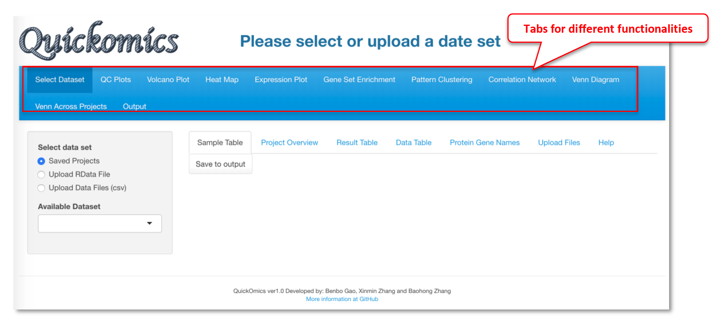
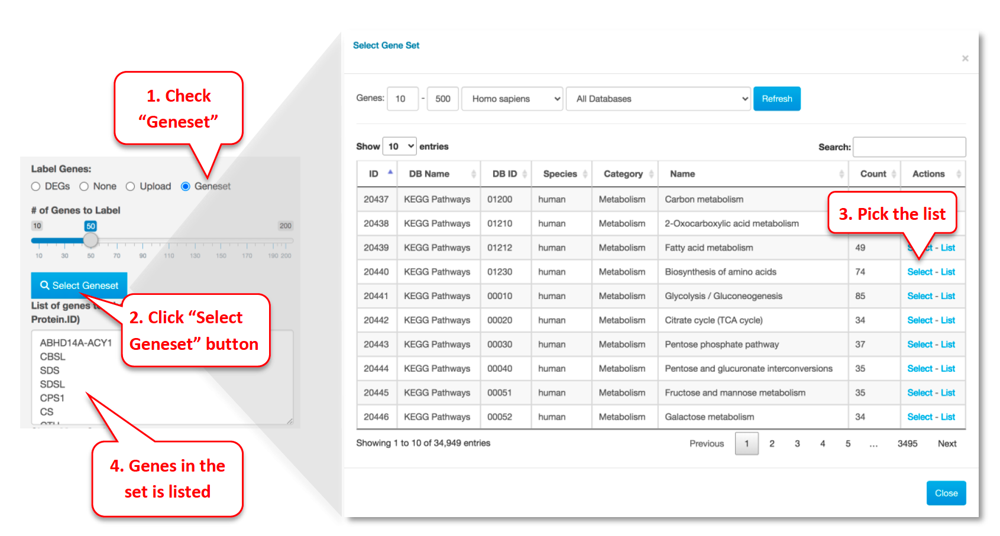

# Introduction

The Quickomics tool can be accessed via the link [https://quickomics.bxgenomics.com](https://quickomics.bxgenomics.com){target="_blank"}. Implemented through R Shiny, it helps with visualizing statistical analysis results for RNAseq and Proteomics datasets. This supplemental tutorial provides a detailed guide on using the different functionalities and customizing the tools to best fit individual analysis and plotting needs, using published RNAseq dataset and proteomics dataset as examples ([Gyoneva et al., 2019](https://www.life-science-alliance.org/content/2/6/e201900453){target="_blank"}; [Connor-Robson et al., 2019](https://www.sciencedirect.com/science/article/pii/S0969996119300968?via%3Dihub){target="_blank"}).

[](Figures/FigureS1_1.png)

The interface contains multiple tabs, corresponding to different functional modules, that can be accessed on top panel of the webpage. Users have the option to upload their own dataset or choose from existing demo datasets for visualization.

## Integrated Gene Set Query

To supply genes in pre-defined gene sets to plotting functions in Quickomics, we developed xGenesets API for Quickomics to query and retrieve a list of genes/proteins when it is needed. The lists can be defined based on pathways, and gene sets from various sources, including KEGG Pathways (Kanehisa and Goto, 2000), WikiPathways (Martens et al., 2020), Small Molecule Pathway Database (Frolkis et al., 2010), Reactome (Jassal et al., 2020), Gene Ontology (The Gene Ontology Consortium, 2019), Molecular Signatures (Subramanian et al., 2005; Liberzon et al., 2015), and LIPID MAPS Proteome Database (Cotter et al., 2006). xGenesets database currently has 175,537 gene sets stored in MySQL tables, covering human (115,497 records), mouse (30,554 records) and rat (29,486 records) gene sets. xGenesets features personalized settings, dynamic drop-down list upon typing for quick gene set selection, full gene set database browsing, and a list of genes from any gene sets. Throughout Quickomics, users interact with this convenient tool in appropriate interface when a gene set is needed by checking “Geneset” option and then clicking on “Select Geneset” to pick a set from a table of available gene sets in a popup window as shown in the following screenshot.

[](Figures/FigureS1.1_1.png)

For developers of web-based applications (general user can skip this paragraph), xGenesets can be easily embedded in any modern websites and online applications, e.g., R Shiny web apps, by leveraging jQuery, DataTables, and bootstrap (either v3 or v4) JavaScript libraries. xGenesets API is freely available for all usages. Examples of using xGenesets API and guidance on setting up the API in your own applications can be found at [https://bxaf.net/genesets](https://bxaf.net/genesets){target="_blank"}.

## Load projects from different data sources

Besides selecting a project in the Dataset module or uploading files, a project can be opened directly with a URL. The part of the URL after `?` tells Quickomics where to find the project. Quickomics can read project files from folders on the server, or fetch the same projects through the QuickOmics API, a separate service that serves project data. When the project loads, a message names the data source, and the source is also shown on the “Project Overview” page of the Dataset module.

| URL | Where the project is loaded from |
|---|---|
| `?datalake=ProjectID` | The data lake, through the QuickOmics API |
| `?api_serverfile=ProjectID` | Published projects, through the QuickOmics API |
| `?serverfile=ProjectID` | Files in server_dir, read directly |
| `?api_testfile=ProjectID` | Unpublished projects, through the QuickOmics API |
| `?testfile=ProjectID` | Files in test_dir, read directly |
| `?unlisted=ProjectID` | Files in the unlisted/ folder of the Quickomics folder |
| `?auto=ProjectID` | Tries the sources above in this order and opens the first one that has the project |

For example, [https://quickomics.bxgenomics.com/?auto=ProjectID](https://quickomics.bxgenomics.com/?auto=ProjectID){target="_blank"} (replace quickomics.bxgenomics.com with your own instance URL). `?auto=` is the easiest choice when you do not know where a project is stored: the data lake has the highest priority, then published projects (through the API, then read directly), then unpublished projects (through the API, then read directly), and finally the unlisted folder. If the project is found nowhere, a message lists the sources that were tried. When a session is saved with “Save Session” (Section 15.2), Quickomics records the source the project actually came from, so the restored session opens the same data.

**Projects stored as files on the server**

**1. Prepare the files for each project**: `projectID.RData`, `projectID_network.RData` and `projectID.csv`. A `wgcna_projectID.RData` file with pre-computed WGCNA results can be added as well.

The csv file should have four columns:

```
Name,ShortName,ProjectID,Species
```

Two optional columns for the csv file include: `ExpressionUnit` (you can enter something like log2(TPM+0.1)), and `Path` (optional path for raw or analyzed data, e.g. Z:/share/GSE158470/).

**2. Put the files in a folder that Quickomics reads.** The simplest way is the unlisted/ folder under the Quickomics folder (`?unlisted=ProjectID`). A better way is to keep the data outside the Quickomics folder: create a config.csv file under the Quickomics folder, for example:

```
category,value
server_dir,/hpc/data/server_files
test_dir,/hpc/data/test_files
```

Make sure the two folders can be read by the Shiny App. Files in server_dir are opened with `?serverfile=ProjectID` and files in test_dir with `?testfile=ProjectID`.

**Projects served by the QuickOmics API**

The `datalake`, `api_serverfile` and `api_testfile` sources need a running QuickOmics API. Its address and login are set on the server in the `.Renviron` file of the Quickomics folder (`QUICKOMICS_API_URL`, `QUICKOMICS_API_USERNAME` and `QUICKOMICS_API_PASSWORD`). If the API cannot be reached, opening a project from one of these sources shows an error, while `?auto=` skips them and continues with the next source.

## ShinyOne

Starting from Quickomics v2.0, we also introduce ShinyOne, a web-based table listing existing projects loaded into Quickomics.

We have pre-loaded several demo data to Quickomics, and the ShinyOne demo site is:

[http://demo.bxgenomics.com:8185/](http://demo.bxgenomics.com:8185/){target="_blank"}
