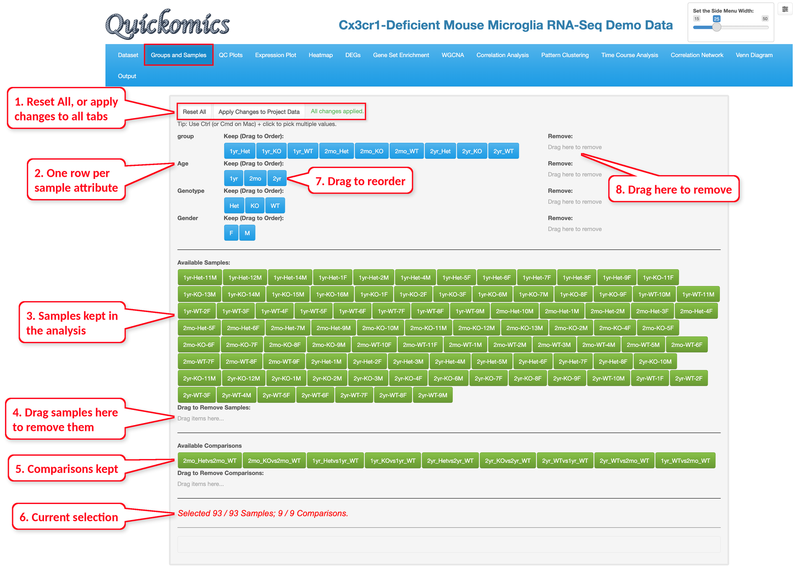
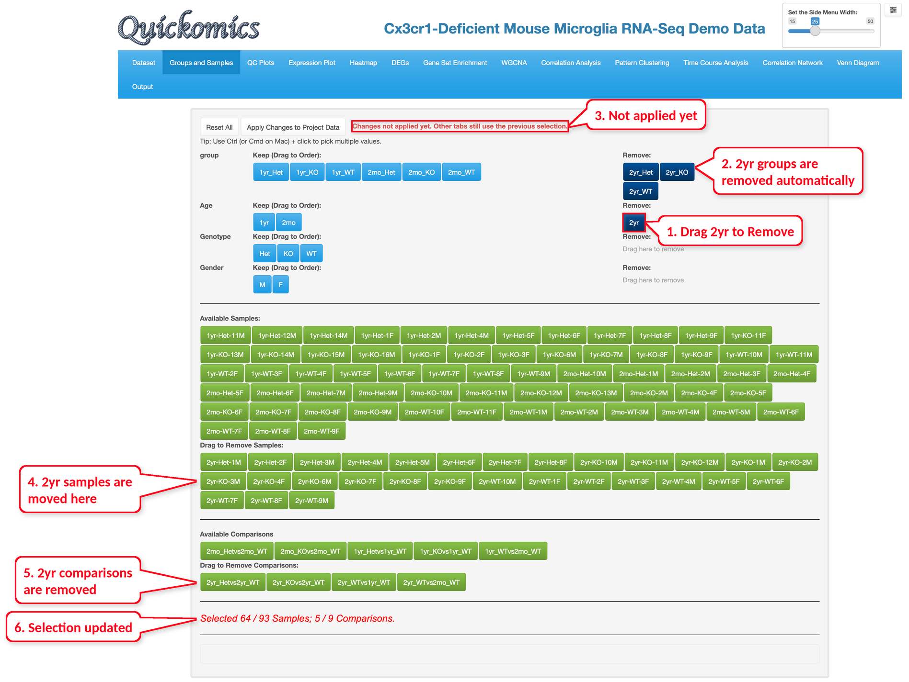
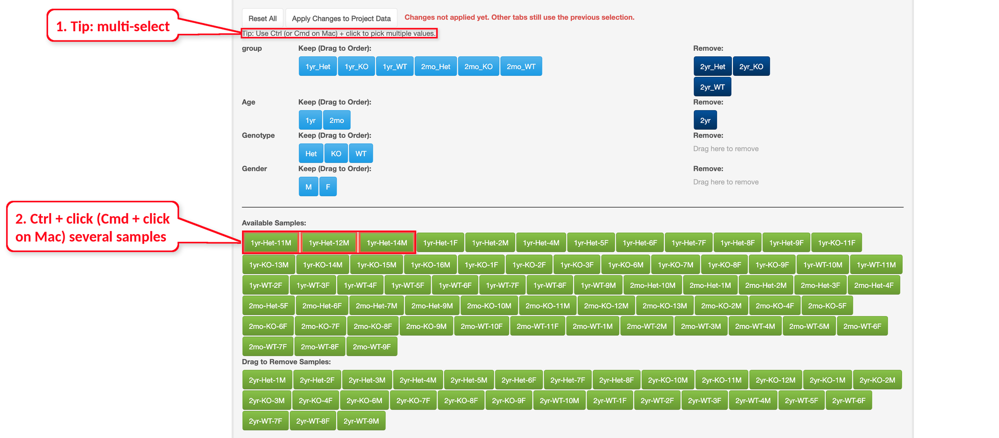
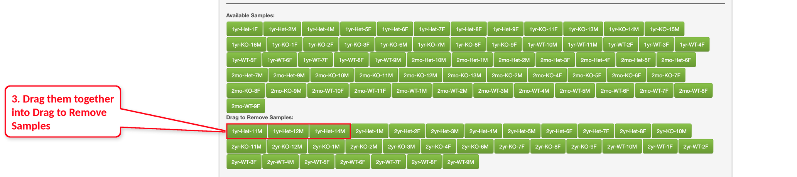
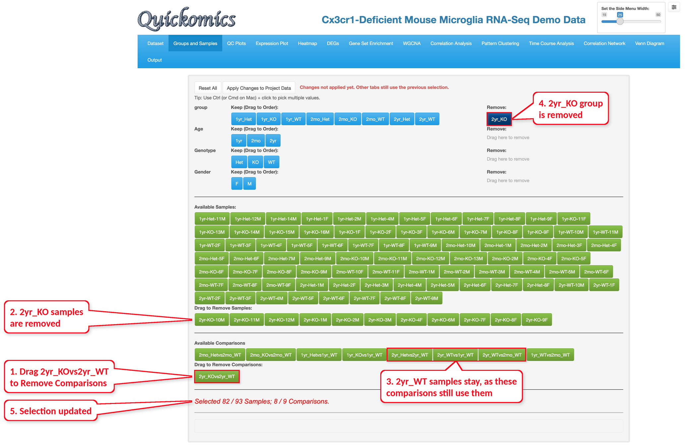
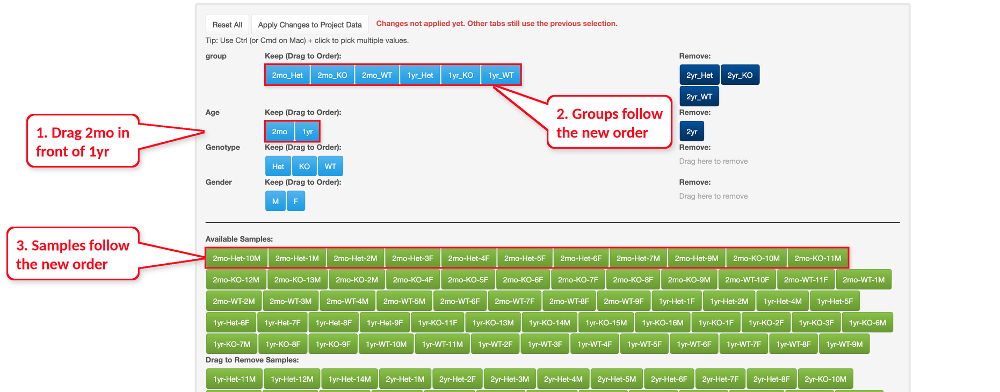
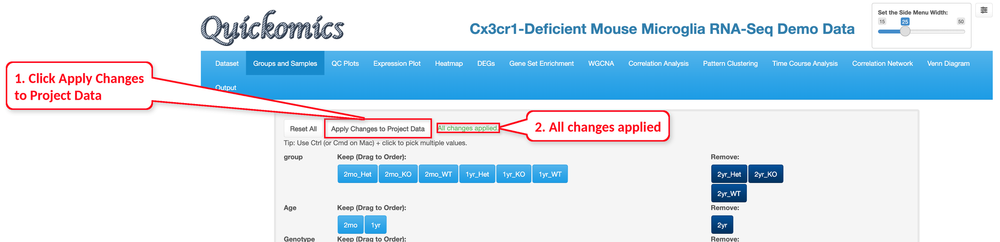

# Groups and Samples Module

The “Groups and Samples” module controls which groups, samples and comparisons are used in the rest of Quickomics. It was first introduced in version 2.0 and has been redesigned in the current version. Users can keep or remove samples by any sample attribute (for example group, Age, Genotype or Gender), remove individual samples or comparisons, and re-order groups and samples, all by clicking and dragging buttons in an interactive manner. Changes are made in this tab first, and are passed on to all other modules only after the User clicks “Apply Changes to Project Data”.

## Overview of the Groups and Samples tab

The tab is organized from top to bottom as shown below, using the Mouse Microglia RNA dataset (Gyoneva et al., 2019) as an example.

At the top, “Reset All” restores the original selection of the project, and “Apply Changes to Project Data” passes the current selection on to all other tabs. The note next to these buttons shows whether the current selection has been applied. The tip below them is a reminder that several buttons can be picked at once with Ctrl + click (Cmd + click on Mac).

Next, each categorical sample attribute has its own row. The values that are kept are listed under “Keep (Drag to Order)” and can be dragged to change their order, while values dragged into the “Remove” box on the right are left out. Attributes that are numeric, have only one value, or have a different value for every sample are not shown as rows. In this dataset, the four rows are group, Age, Genotype and Gender.

Below the attribute rows, “Available Samples” lists every sample currently included, and “Available Comparisons” lists the comparisons currently included. Individual samples or comparisons can be dragged into the “Drag to Remove Samples” or “Drag to Remove Comparisons” boxes. The line at the bottom summarizes the current selection, here **93 / 93** samples and **9 / 9** comparisons.

## Remove groups by sample attributes

To remove all samples sharing an attribute value, drag that value from “Keep” to the “Remove” box of the same row. In the example below, we drag **2yr** from the Age row to “Remove” to focus on the 2mo and 1yr microglia. Quickomics updates everything else automatically: the **2yr_Het**, **2yr_KO** and **2yr_WT** groups are moved to “Remove” in the group row, the 2yr samples are moved to “Drag to Remove Samples”, and the four comparisons involving 2yr groups are moved to “Drag to Remove Comparisons”. The summary now shows **64 / 93** samples and **5 / 9** comparisons.

The selection is made step by step, so each change starts from the samples currently kept. Dragging a value back to “Keep” adds its samples back, except samples carrying a value that is still removed in another row.

The red note “Changes not applied yet. Other tabs still use the previous selection.” is a reminder that the new selection has not been passed on to the other tabs yet (see Section 3.6).

## Select and remove multiple samples

Individual samples, for example outliers identified in the QC Plots module, can be removed by dragging them from “Available Samples” to “Drag to Remove Samples”. To move several samples at once, hold Ctrl (Cmd on Mac) and click each sample; the selected samples are outlined in red.

Then drag any one of the selected samples, and all of them move together. Here, the three samples **1yr-Het-11M**, **1yr-Het-12M** and **1yr-Het-14M** are moved to “Drag to Remove Samples”. Comparisons that relied on the removed samples are removed as well; in this example **1yr_Hetvs1yr_WT** is moved to “Drag to Remove Comparisons”, and the summary shows **61 / 93** samples and **4 / 9** comparisons. Multiple selection works the same way for attribute values and comparisons.

## Remove samples by comparisons

Samples can also be selected through the comparisons. When a comparison is dragged from “Available Comparisons” to “Drag to Remove Comparisons”, its samples are removed as well, but only the samples that no remaining comparison uses. In the example below, we remove **2yr_KOvs2yr_WT**. The eleven 2yr_KO samples are used only by this comparison, so they are moved to “Drag to Remove Samples”, and the **2yr_KO** group is moved to “Remove” in the group row. The 2yr_WT samples are kept, because they are still used by **2yr_Hetvs2yr_WT**, **2yr_WTvs1yr_WT** and **2yr_WTvs2mo_WT**. The summary now shows **82 / 93** samples and **8 / 9** comparisons.

Dragging a comparison back to “Available Comparisons” adds its samples back.

## Reorder groups and samples

The order of the buttons in each “Keep” box sets the order used in plots and tables. In this example, we drag **2mo** in front of **1yr** in the Age row, so that the younger animals come first. The groups are re-ordered to **2mo_Het**, **2mo_KO**, **2mo_WT**, **1yr_Het**, **1yr_KO**, **1yr_WT**, and the samples in “Available Samples” follow the new order. Groups, samples and comparisons can also be re-ordered directly by dragging them within their own boxes. Re-ordering comparisons does not change which samples are kept.

## Apply changes to all modules

When the selection is final, click “Apply Changes to Project Data”. The note changes to “All changes applied.”, and all other modules (QC Plots, Expression Plot, Heatmap, DEGs and so on) now use the selected groups, samples and comparisons in the selected order.

