# QC Plots Module

The “QC Plots” module performs basic QC analyses, as described in following paragraphs, on an uploaded dataset to evaluate integrity and quality of the data. The plots were generated using ggplot, plotly, ComplexHeatmap and pheatmap R packages. All QC plots use the groups, samples and comparisons selected in the “Groups and Samples” module (Chapter 3), and the current selection is shown at the top of the left panel. The width of the left panel can be adjusted with the “Set the Side Menu Width” slider in the upper right corner of the page (15–50% of the page width; the small icon next to it shows or hides the slider). This setting applies to all modules.

## PCA Plot

The principle component analysis (PCA) plot displays, by default, the first 2 PC’s in the dataset and colors study groups with “none” selected in shape and size settings. This plot is highly customizable. Users can change the display by annotating the plot with different colors, shapes, size scheme, as well as label selected subsets data points. The PCA settings are shared by the other PCA-based tabs in this module, such as “Eigenvalues”, “PCA 3D Plot” and “PCA 3D Interactive”.

[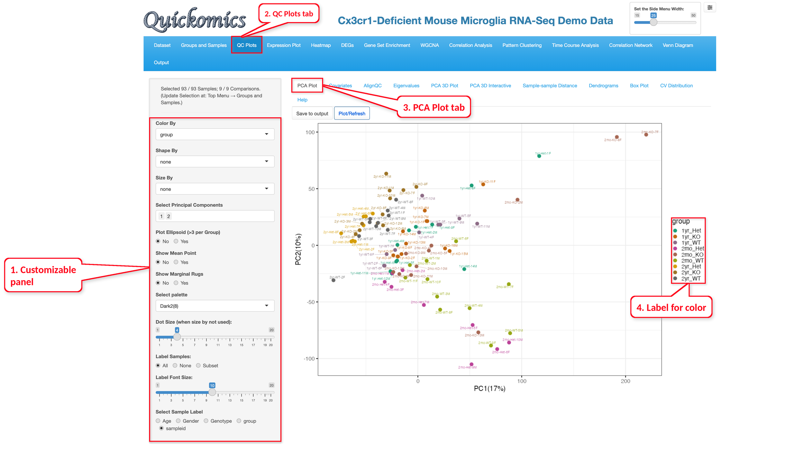](Figures/FigureS4.1_1.png)

To illustrate the strengths of customization, we changed a few display elements as shown below, to visualize the influence of Age and Genotype on sample clustering:

We added the Plot/Refresh button to graphs that take time to generate. We also enhanced user interface to show plot progress and display initial plot.

[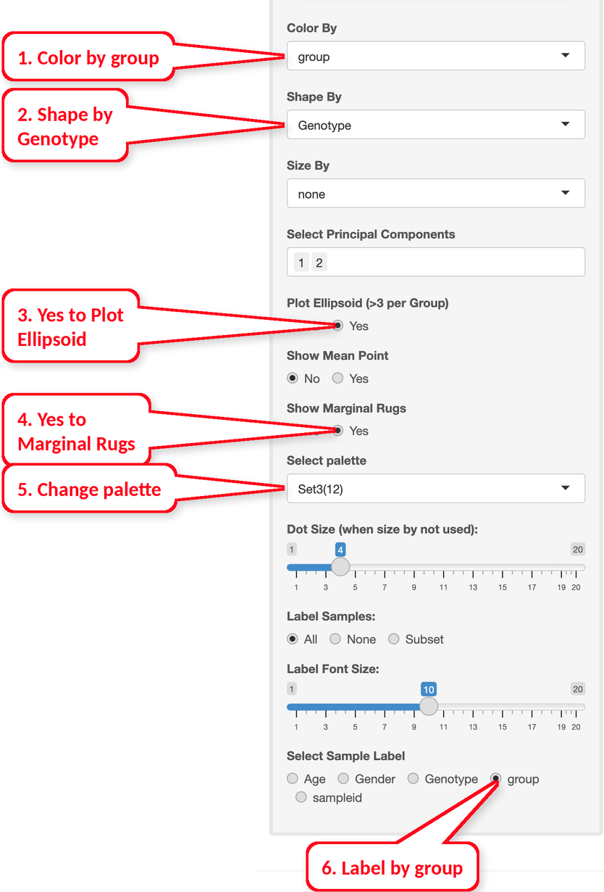](Figures/FigureS4.1_2.png)

In the resulting PCA plot, the 2mo groups separate from the 1yr and 2yr groups, mostly along PC2, which agrees with Age being the factor that drives the biggest separation in this dataset. There is some separation driven by the Genotype as well. Two 2mo_KO samples (2mo-KO-7F and 2mo-KO-8F) lie far from all other samples along PC1. The Ellipsoid feature helps group samples by the color attribute, while the Marginal Rug feature helps understand the sample distribution along the axis.

[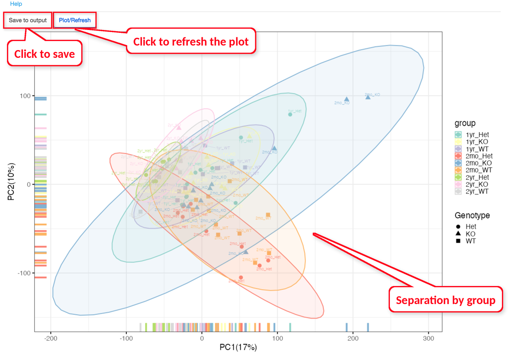](Figures/FigureS4.1_3.png)

Furthermore, the plot can be saved in high resolution by clicking on “Save to Output”. Chapter 15 of this document describes the next steps of downloading and obtaining the saved plots.

## Covariates

The Covariates tab provides flexibility to visualize the covariates, such as Age, group, Genotype showing here. This table contains several columns including the Significance, p-value, and FDR for each covariates listed. Users can also adjust the covariates and cutoffs on the left.

[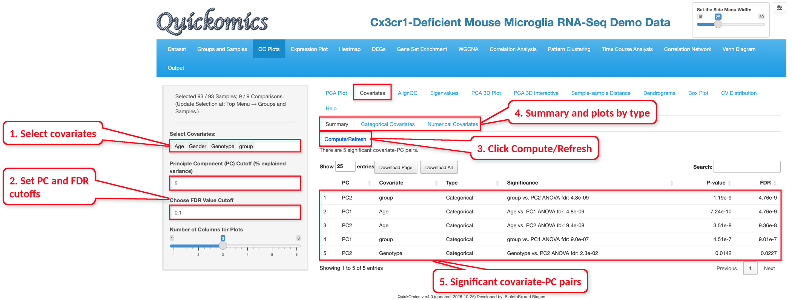](Figures/FigureS4.2_1.png)

## AlignQC

The AlignQC tab contains several sub-tabs to visualize the QC metrics of the alignment step. Here, we can check the 'Top Gene Ratio', 'Top Gene List', 'Mapped Read Allocation', or 'Plot Other Variables' across samples. More details can be adjusted on the left panel, such as the height, width, and font size of the plot. The 'Save to output' function can add the current plot in the output list.

[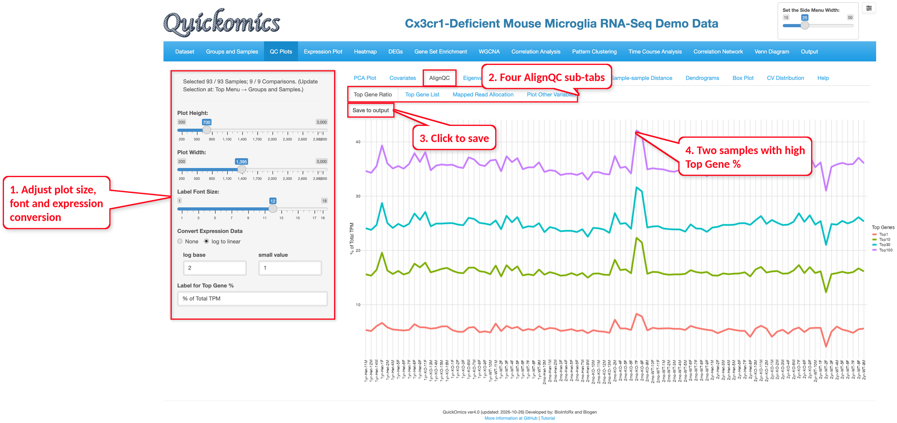](Figures/FigureS4.3_1.png)

## Eigenvalues

By default, the PCA plot displays PC1 and PC2 as described in Section 4.1. However, in many cases other PC’s may be important in explaining additional variance in the dataset. This sub-tab generates a plot of the variances versus the first 10 PCs in the dataset, enabling Users to make educated decisions of which PCs to plot in 2D scatter plot. In this dataset PC1 and PC2 together explain around 27% of the variance.

[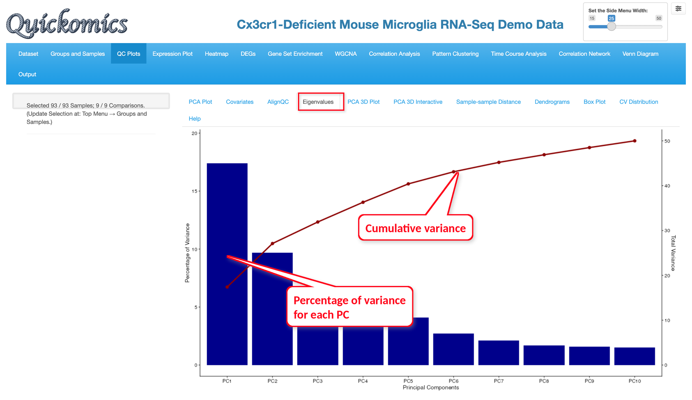](Figures/FigureS4.4_1.png)

PC2 and PC3 were used to redo the PCA plot, but here the factors driving the separation of the samples is not as clear.

[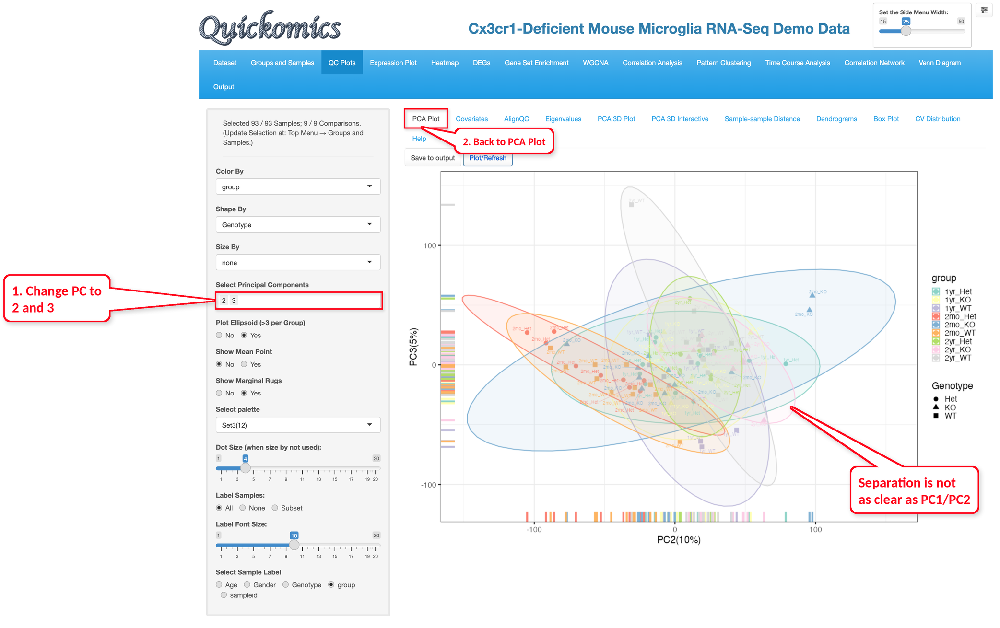](Figures/FigureS4.4_2.png)

## PCA 3D Plot

This sub-tab contains a way to perform 3D PCA representation. The functionality is limited to doing so only on PC1, PC2 and PC3. Users can zoom in and out to focus on different areas of the plot or rotate the plot in different axes to find the best separation by age as shown below. There are 3 attributes that can be changed: color, ellipsoid inclusion, and labels of the samples.

[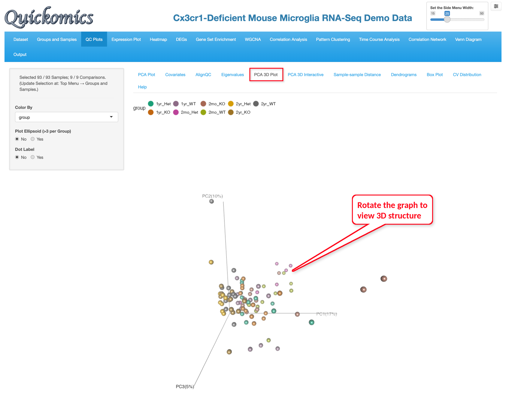](Figures/FigureS4.5_1.png)

The “Color By” and “Plot Ellipsoid” attributes were changed in the following plot. This highlights the clear separation of samples by Age and not Genotype, contrary to the original biological hypothesis.

[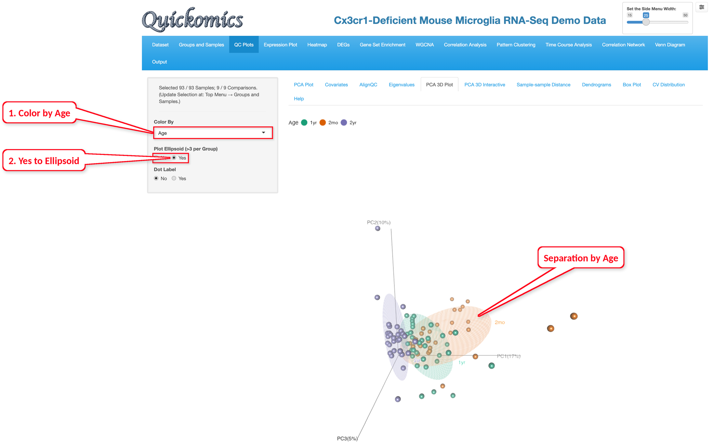](Figures/FigureS4.5_2.png)

## PCA 3D Interactive

This tab is similar to the previous one (4.5 PCA 3D Plot), but here users have the additional capability to hover over the samples on the plot to identify more details, see the pointer below. This was implemented through the plotly package in R. Users can change 2 attributes here, the color and shape.

[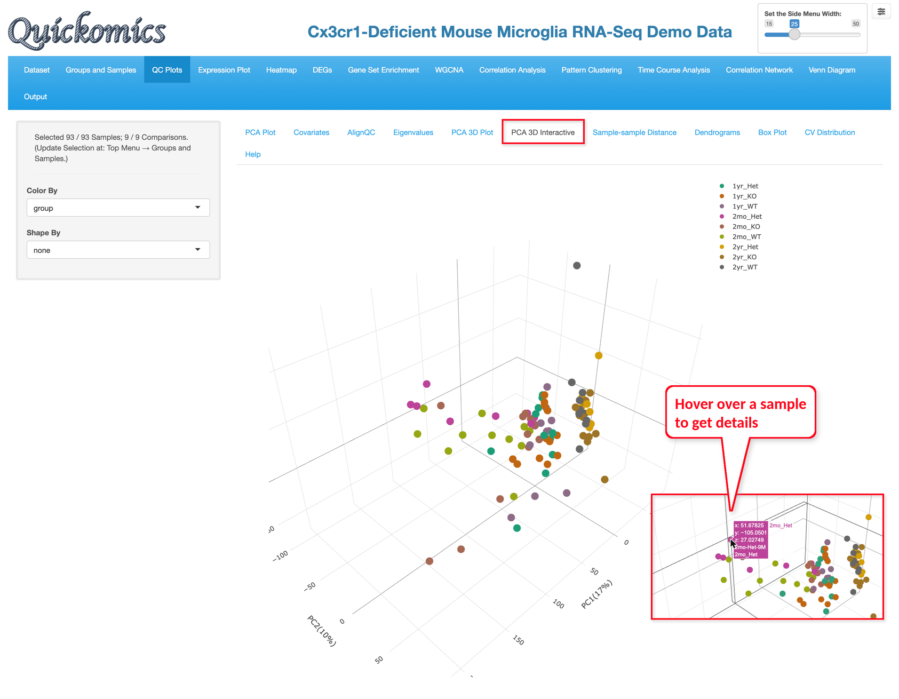](Figures/FigureS4.6_1.png)

In the plot below, the “Color By” and “Shape By” attributes have been changed to highlight the drivers of separation.

[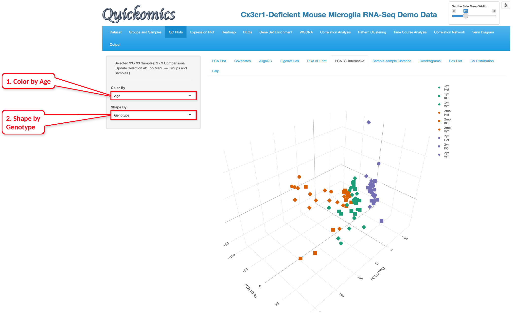](Figures/FigureS4.6_2.png)

## Sample-sample Distance

This tab helps identify pair-wise similarity between all samples. It has three sub-tabs: “Distance Heatmap”, “Correlation Heatmap” and “Correlation Data Table”. A short description above each heatmap explains how it is computed. Here again, Users have the option to save the heatmaps to output.

The “Distance Heatmap” shows the Euclidean distance between every sample pair, computed from the expression values. Smaller distances mean that two samples have more similar overall expression profiles. By default, the rows and columns are clustered based on similarity; this can be turned off with “Apply Clustering”. It is clear from this plot that samples of the same Age have the smaller distances, that is, they have closer gene expression patterns.

[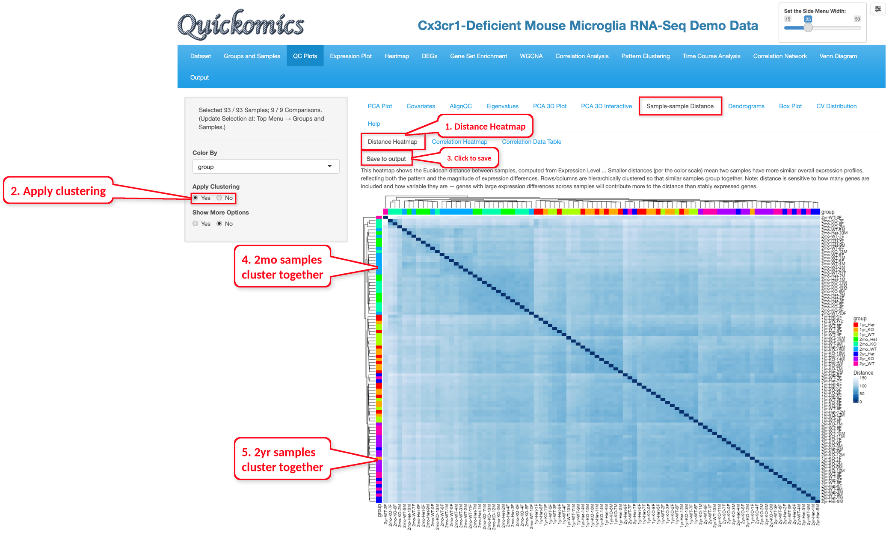](Figures/FigureS4.7_1.png)

The “Correlation Heatmap” shows the correlation between every sample pair. Unlike the distance, the correlation is scale-invariant, so it highlights shared expression patterns rather than absolute differences in expression. Users can choose how the samples are annotated (“Annotate By”) and labeled (“Axis Label By”), and whether to apply clustering. Selecting “Yes” under “Show More Options” gives further control over the heatmap colors, the colors of the annotations (set automatically by a random seed, selected from palettes, or uploaded as a csv file), font sizes and plot height. In this example, the samples are annotated by Age, and samples of the same Age are highly correlated with each other.

[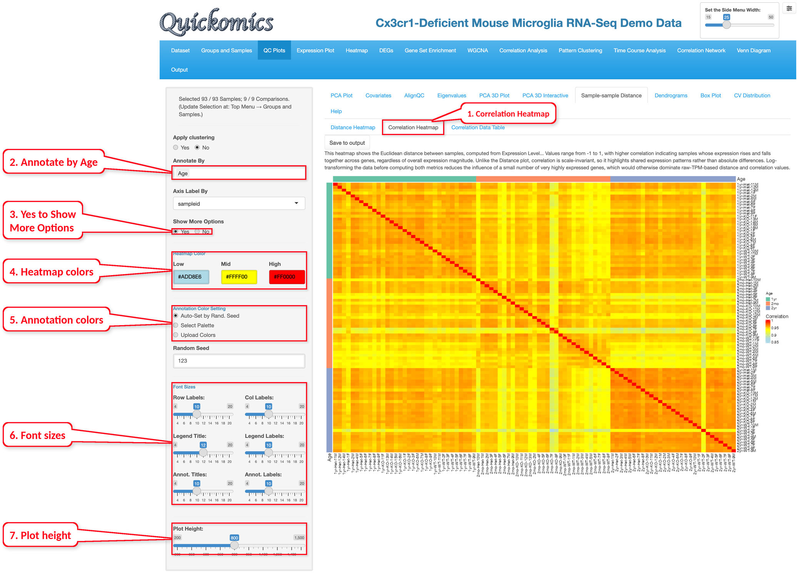](Figures/FigureS4.7_2.png)

The “Correlation Data Table” lists the correlation values of all sample pairs in a searchable table, which can be downloaded by page or as a whole.

[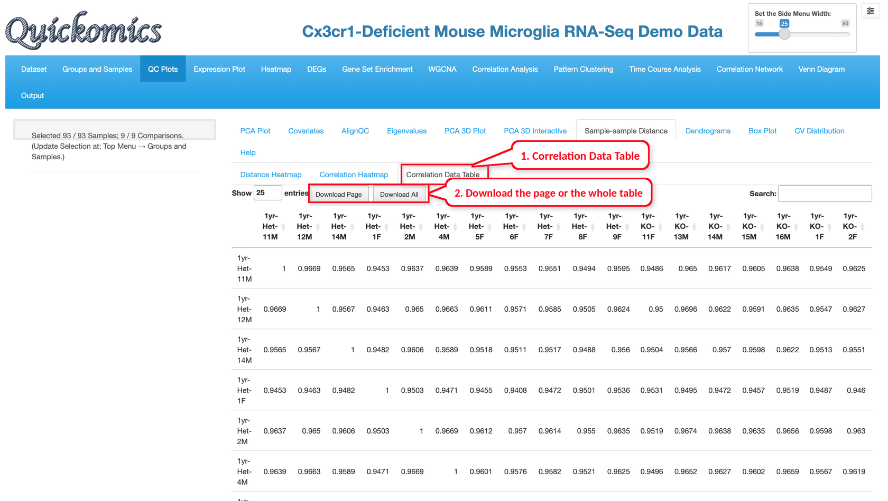](Figures/FigureS4.7_3.png)

## Dendrograms

Like the previous plot (4.7 Sample-sample Distance), the Dendrogram plot helps visualize hierarchical clustering relationships between samples. The Default plot is Circular and cut into four parts. Users have the option to visualize in two other ways (tree or horizontal) and cut the plot in multiple regions. Here again, Users can save the plot to output.

[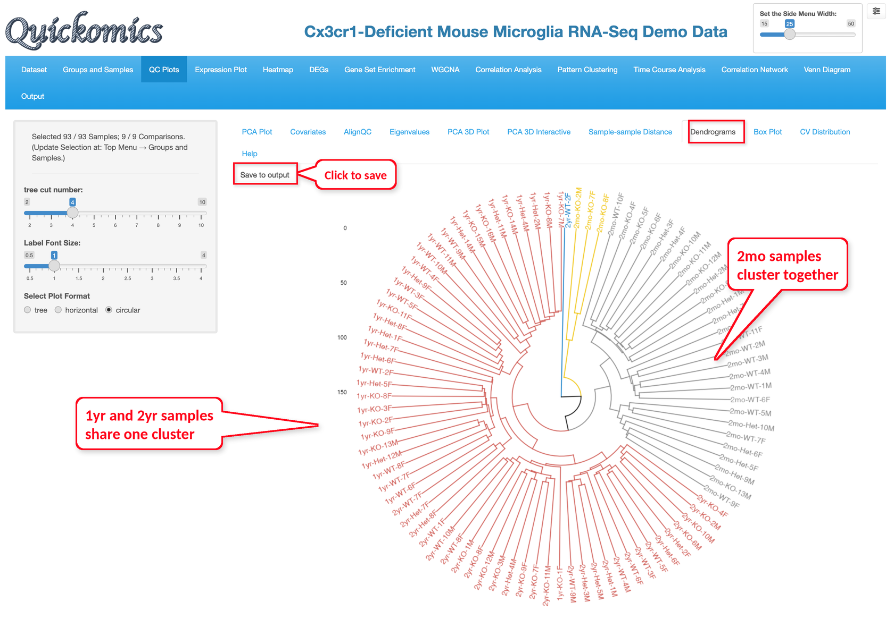](Figures/FigureS4.8_1.png)

In the plot below, we have selected to visualize as a tree and cut into eight parts. This shows the relationship between the samples to help understand the hierarchal clustering. Overall, the samples are arranged by age, but there are some outliers that appear. The 2mo samples form their own branches, while the 2yr samples cluster together with part of the 1yr samples.

[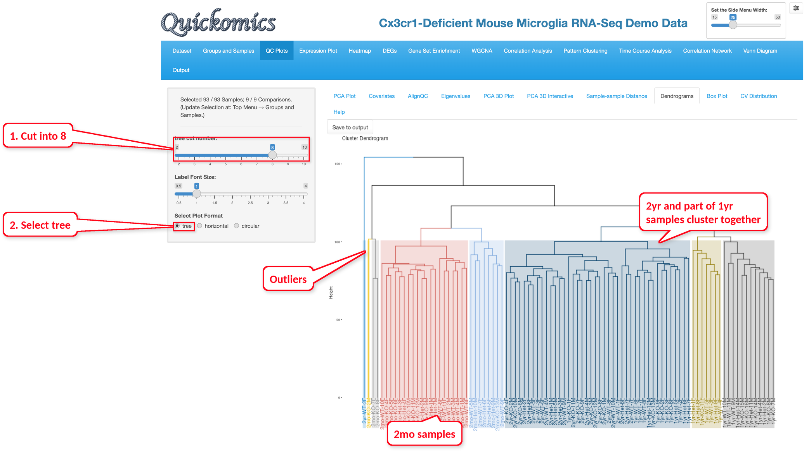](Figures/FigureS4.8_2.png)

## Box Plot

The Boxplot is a visualization to understand the distribution of the normalized expression levels in all samples. This identifies the minimum, first quartile, median, third quartile, and maximum values in the dataset. In this demo dataset, most of the samples have the same range of expression, indicating that there are no outliers.

[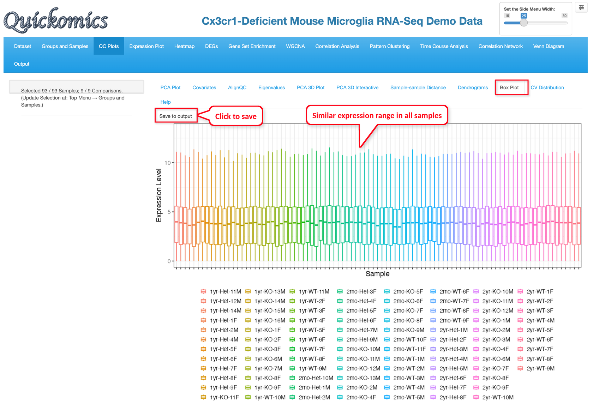](Figures/FigureS4.9_1.png)

## CV Distribution

This plot shows the histogram of CVs (coefficient of variation) and a dotted line for each group indicates the median CV. In this dataset, the 2mo_KO samples have the highest CV while the 2yr_Het samples have the lowest variability, which corresponds to what is visually seen on the PCA plot for these samples in Section 4.1.

[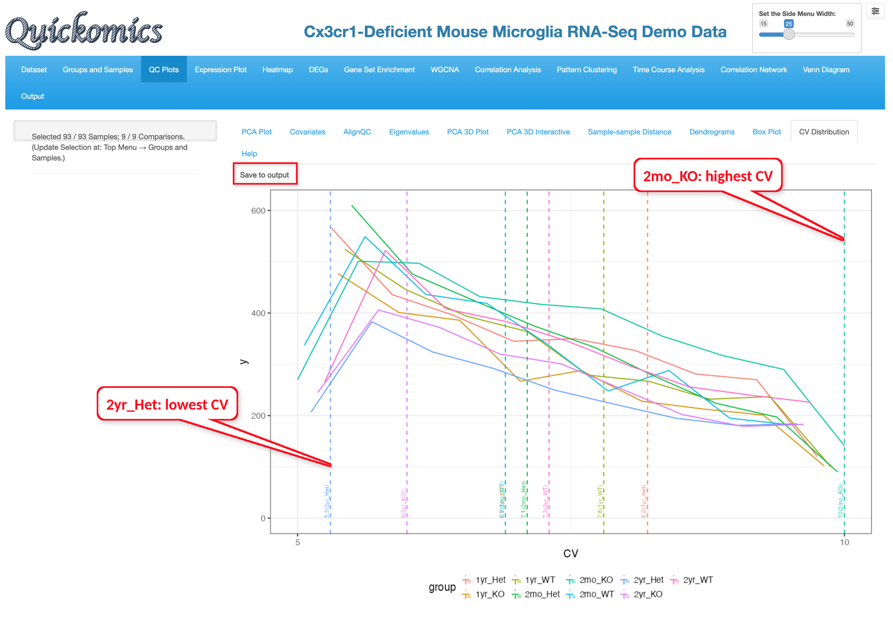](Figures/FigureS4.10_1.png)

## Help

The Help section describes each tab of the QC Plot and what is being visualized. For further help please visit the GitHub containing the source code for this tools ([https://github.com/interactivereport/Quickomics](https://github.com/interactivereport/Quickomics){target="_blank"}) or click on the link at the bottom of the page.

[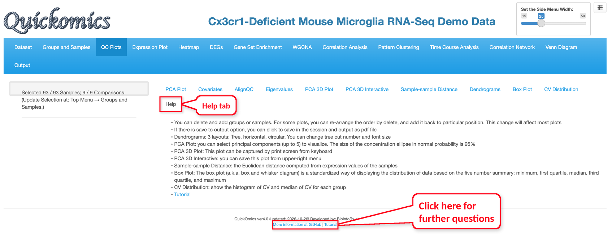](Figures/FigureS4.11_1.png)

