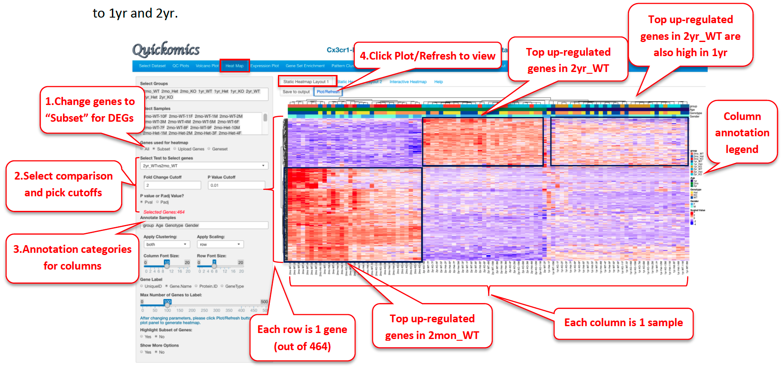
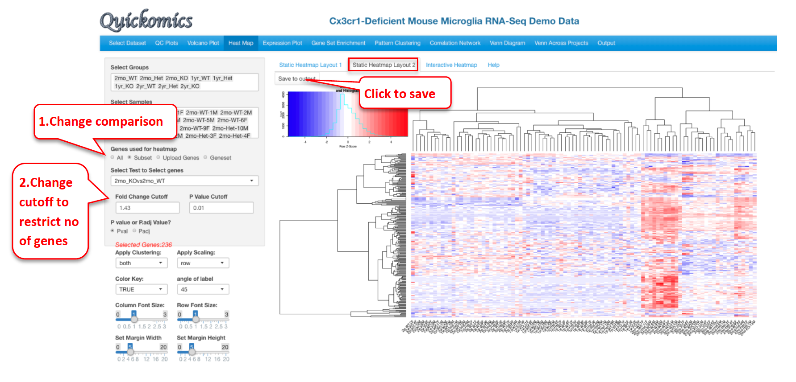
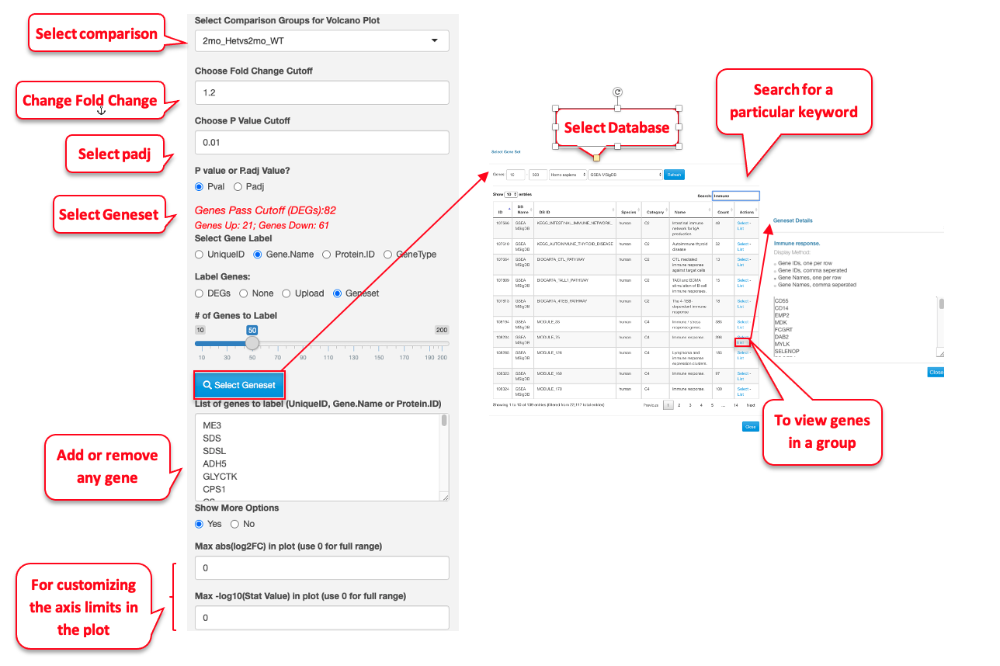
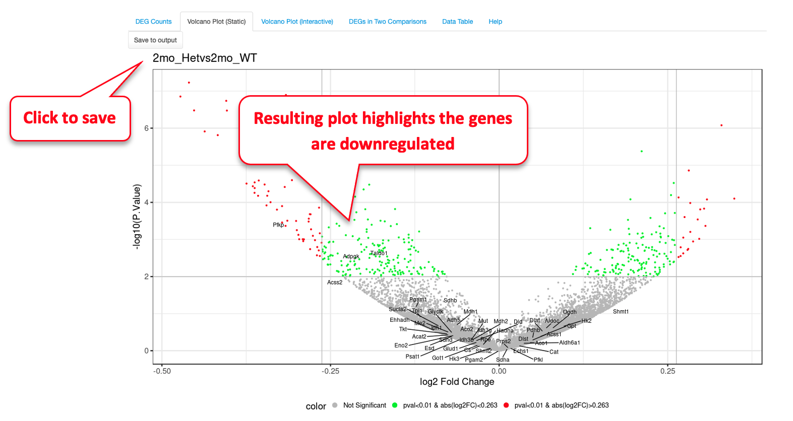
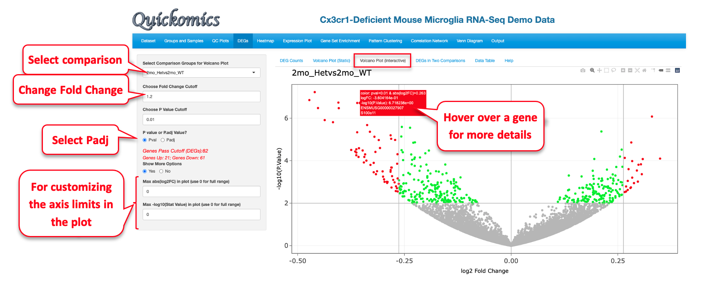
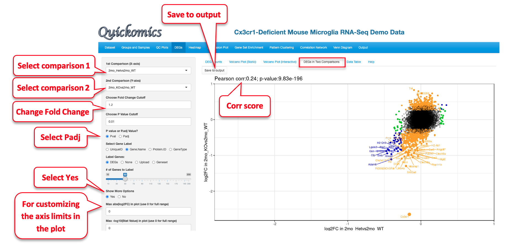
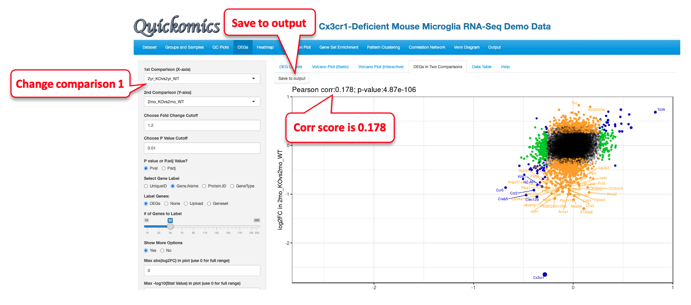
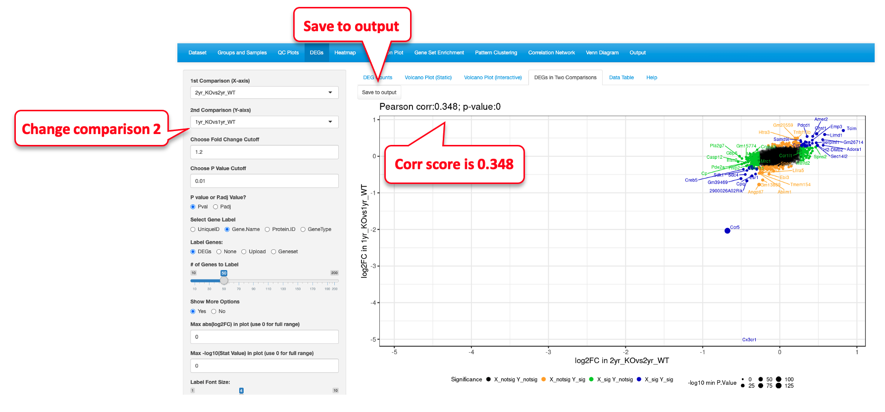
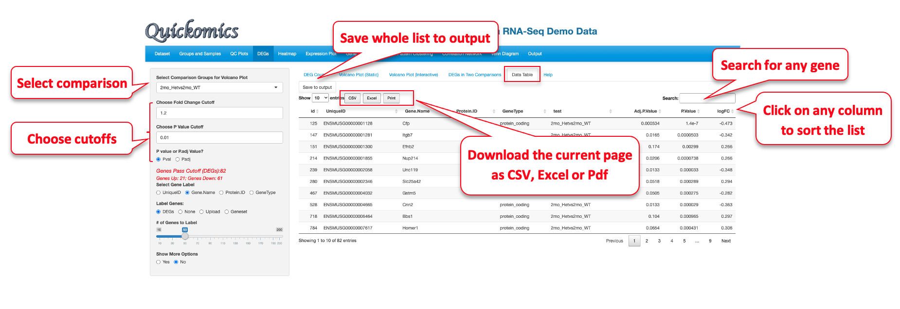

# DEG Module

This section is designed to explore the differentially expressed genes (DEGs) and differentially expressed proteins (DEPs) in the dataset. The comparisons are defined by the User when they input the dataset. Please refer to our GitHub for more details on uploading datasets.

The “Volcano Plot (Static)” described in Section 5.2 and “Volcano Plot (Interactive)” described in Section 5.3 are ways to visualize each pair-wise comparison one by one. “DEGs/DEPs in Two Comparisons” described in Section 5.4 is a novel way to visualize the similarities and differences in two comparisons. Finally, “Data Table” described in Section 5.5 displays a searchable table containing all genes and their fold changes and P values in each comparison.

## DEG Counts

The DEG Counts tab provides a summary of the number of significantly changed genes for each comparison, separating Up- and Down-regulated genes.

## Volcano Plot (Static)

This plot reveals the differentially expressed genes provided in the input data file. By default, the Fold change Cutoff is set to 1.2 and the P value Cutoff is set to 0.01. Users have the option to change any of these parameters. For more advanced display options, they can set the “Show More Options” to “Yes” to customize other settings.

The red dots are indicative of all genes that pass the Fold Change and P value cutoff, while the green dots are indicative of genes that only pass the P value cutoff. By default, 50 randomly chosen DEGs are labeled.

For demonstration purposes, we have changed the following attributes to highlight a few genes in this dataset. We have selected the 2mo_KOvs2mo_WT comparison, where [Gyoneva et al., 2019](https://www.life-science-alliance.org/content/2/6/e201900453){target="_blank"} report immune response genes as the top differentially expressed category. To highlight these genes, in the example below, we select an “Immune Response” dataset from the Molecular Signatures Database (MSigDB) to highlight the genes by adding labels to the volcano plot. As MSigDB contains only human gene lists and the demo dataset is from mouse, Quickomics does a quick conversion of the names of Human genes to Mouse genes by changing the letters after the first one to lowercase. The genes of the selected gene set are listed in the box below the “Select Geneset” button, where genes can be added or removed. If the list contains more genes than the number set by “# of Genes to Label” (50 by default), only that many are labeled. The label color can be changed with “Gene Label Color”. To keep the plot readable, we also set “Max -log10(Stat Value) in plot” to 20 under “Show More Options”. Several of these immune genes, such as Hfe, Cfp and Cybb (down) and Klf6 and Il7r (up), are significantly changed. This view was not available in the original publication.

A set of genes can also be shown in a different color. Select “Yes” under “Highlight a Set of Genes in a Different Color?”, enter the genes to highlight, choose their color, and enter the genes from this list that should be labeled; genes entered in the label box are always labeled. Then click “Apply Highlight”. The highlight list and labels work separately from “Label Genes”, so in the example below we set “Label Genes” to “None” and highlighted immune genes that [Gyoneva et al., 2019](https://www.life-science-alliance.org/content/2/6/e201900453){target="_blank"} report as changed in 2mo KO microglia. Most of them, such as the MHC class II genes (H2-Aa, H2-Ab1, H2-Eb1), Ccr5 and Mmp9, are down-regulated, while Tnf, Egr1 and Klf2 are up-regulated. Genes can also be sent to this list from the interactive volcano plot (Section 5.3).

Under “Show More Options”, “Rasterize plot” draws the dots as a bitmap image while keeping the text and axes sharp, which makes saved plots smaller when there are many genes.

## Volcano Plot (Interactive)

This next sub-tab is a very similar visualization as the previous one (5.2 Volcano Plot (Static)) with an additional capability where users can hover over a particular dot/gene on the plot to see more details. This plot has a few attributes that can be changed, and in the example below we have used the same cutoffs as in Section 5.2.

Genes can also be selected directly on the plot. Choose the lasso or box-select tool in the toolbar at the top right of the plot and circle a group of dots; the number of selected genes and a table of these genes (with their logFC, P value and adjusted P value) appear below the plot, and the table can be downloaded as CSV or Excel. Double-clicking the plot clears the selection. Clicking “Send Selected Genes to Highlight List” copies the selected genes to the highlight list of the static volcano plot (Section 5.2), where they can be shown in a different color after clicking “Apply Highlight”. In the example below, 76 strongly down-regulated genes in 2mo_KOvs2mo_WT were selected.

## DEGs and DEPs in Two Comparisons

This next tab helps with identifying DEGs/DEPs that follow a similar trend in two comparisons. [Gyoneva et al., 2019](https://www.life-science-alliance.org/content/2/6/e201900453){target="_blank"}, the source of this demo dataset, report that the genes differentially expressed in **Cx3cr1 KO** microglia in the **2mo KO** are quite different from WT, while the differences from WT are smaller for the 1yr KO and 2yr KO, and the two older ages are similar to each other. We have plotted out the following comparisons that illustrate this conclusion.

**2mo_KOvs2mo_WT** vs **1yr_KOvs1yr_WT** has a low correlation score of 0.211. There are many genes that are colored orange, meaning those genes were significant in **2mo_KOvs2mo_WT (Y axis)** but not in **1yr_KOvs1yr_WT (X axis)**.

Similarly, we changed the X axis to **2yr_KOvs2yr_WT** to compare to **2mo_KOvs2mo_WT**, and it shows a very similar plot with a low correlation score of 0.178.

Next, we changed the Y axis comparison to **1yr_KOvs1yr_WT** comparing it to **2yr_KOvs2yr_WT** on the X axis. This plot has a higher correlation score of 0.348 than the previous one, suggesting that these two comparisons are more similar. These comparisons represent additional insights supported by statistical analyses that were gained from the data and were not available in the original manuscript by Gyoneva et al.

Under “Show More Options”, “Color DEGs using dot color?” sets whether the gene labels take the color of their dots (“Yes”) or are all drawn in one color (“No”).

## Data Table

This tab lets the users view the DEGs/DEPs in a tabular format with a searchable feature. Users also have the ability to download the gene list as a CSV.

