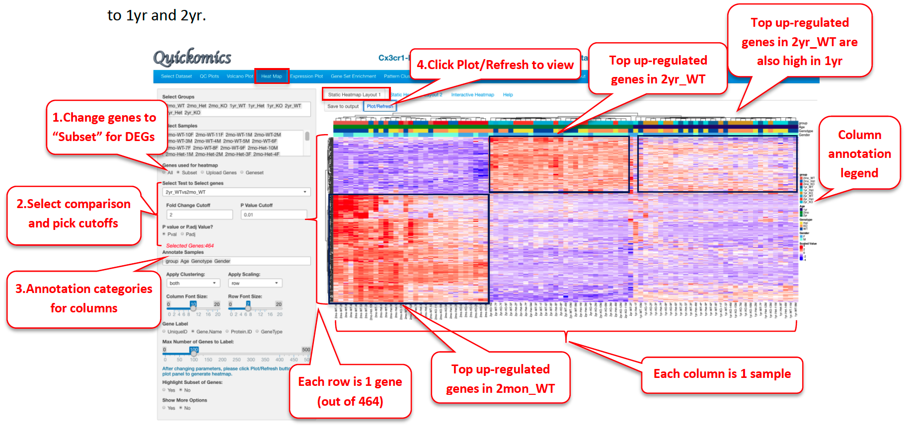
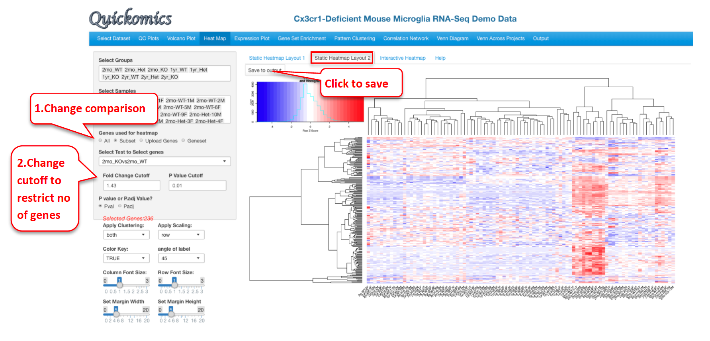
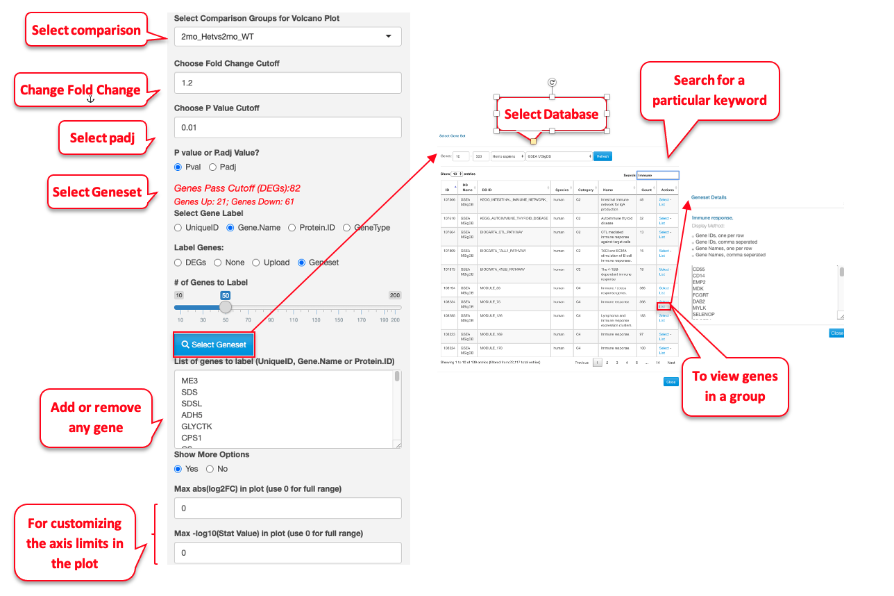
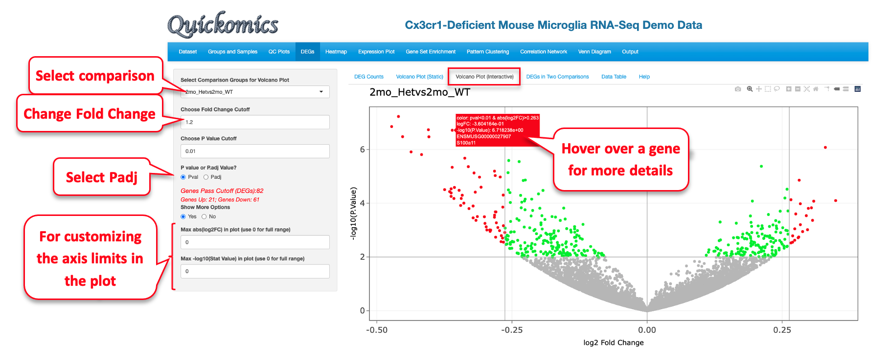
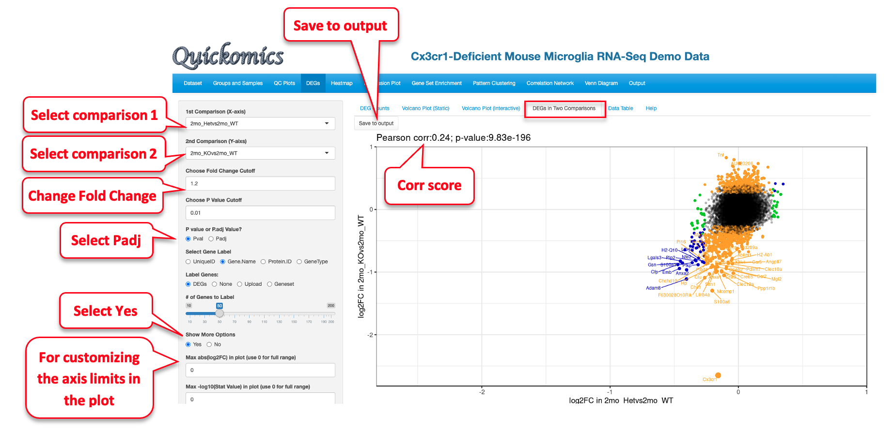
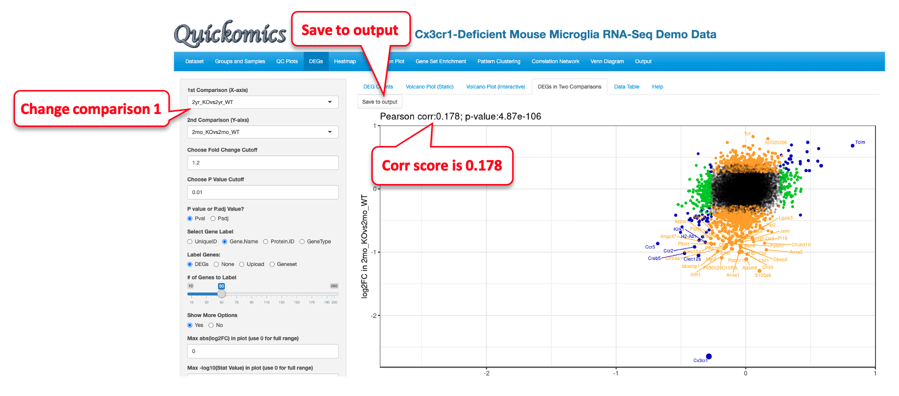
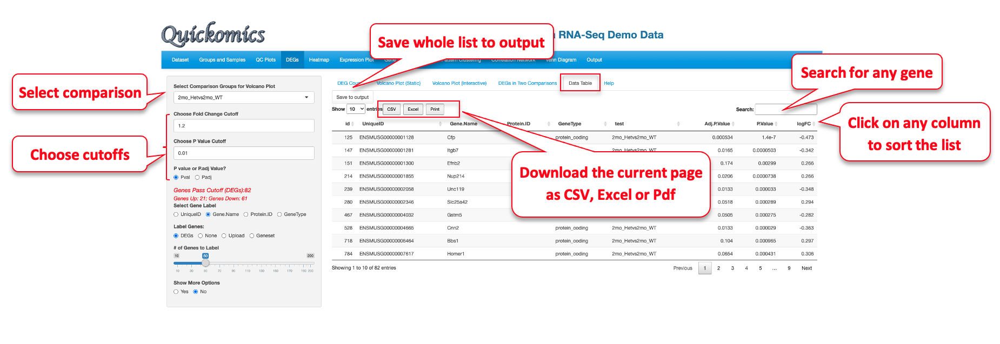

# Expression Plot Module

This functional module allows Users to browse through a subset of genes/proteins. It also offers an option to plot expression of individually selected genes. Four different displays: Box Plot, Bar Plot, Violin Plot and Line Plot are made available to fit the Users’ preference. In Quickomics v2.0, we enhanced the Expression Plot module: genes in the Browsing tab can be ordered by fold change or P value, and the number of columns in the graph can be changed.

## Browsing

This tab lets the Users plot out the expression of the DEGs/DEPs identified in the different comparisons. Select a comparison under “Select Test” and set the fold change and P value cutoffs in the left panel (1.2 and 0.01 by default; “P value or P.adj Value?” chooses which P value is used). The number of genes that pass the cutoffs is shown in red. The genes are ordered by absolute fold change or by P value (“Order Genes by”), and are plotted 4, 6 or 9 per page; “Select Page” moves through the pages. Click “Plot/Refresh” to draw the plots after changing these settings. In this example below, we demonstrate how to display a few top genes as Violin Plots.

## Searched Expression Data

Another way to plot genes/proteins is using this functionality. The genes/proteins can be picked in three ways under “Genes Used in Plot”: “Select” to search for genes by name, “Upload Genes” to paste a list of genes, or “Geneset” to choose a gene set from databases such as KEGG and MSigDB with the gene set search described in Section 1.1. The selected genes/proteins can be plotted in separate plots or in one plot (“Separate or One Plot”); one plot supports only the Bar and Line formats. Click “Plot/Refresh” to draw the plot. Here is an example of plotting genes involved in MHCII antigen processing.

The resulting plot shows the expression of a subset of genes from the MHCII antigen presentation family of genes. Many of them appear altered by gene KO in 2mon microglia, but also in all genotypes in 2yr microglia, as indicated in the publication.

The left panel offers the same plot options in the Browsing and Searched Expression Data tabs. Besides the plot format, Users can show or hide the individual sample points, choose the sample attribute on the X axis and the one used for colors (“Color By”), and change the palette, fonts, labels, X label angle and number of columns. “Y Axis Scale” shows the values on the log scale of the expression unit or converts them back to the linear scale, using the log base and small value of the unit (for example 2 and 0.25 for log2(TPM+0.25)); “Y Axis Range” can be set manually.

## Data Table

This sub-tab lists the normalized data of the genes/proteins selected in “Searched Expression Data” (Section 5.2) as a searchable table. For a demo of this feature, we select a proteome dataset from published paper ([Connor-Robson et al., 2019](https://www.sciencedirect.com/science/article/pii/S0969996119300968?via%3Dihub){target="_blank"}).

Once the dataset is selected, we go into the “Searched Expression Data” sub-tab to select a gene set. We chose “Geneset” and clicked “Select Geneset”; in the dialog, we set the species to Homo sapiens, searched for “kinase”, sorted the gene sets by Count in ascending order, and selected the first one, phosphatidylinositol bisphosphate kinase activity (GO:0052813, 10 genes). Six of its genes are found in the dataset, and after clicking “Plot/Refresh” their expression is shown for each group. Several of these kinase genes, such as PIK3CA, PIK3CD and PIP5K1C, are lower in the disease samples than in the controls.

Finally, we click the “Data Table” tab to look at the expression of the protein selected for a searchable table of values. The “Table Format” option in the left panel shows the table in wide or long format. In the default wide format, each row is one gene/protein, the first columns give its IDs (such as UniqueID and Gene.Name), and each sample is a column, so the table has 6 rows, followed by one column for each of the 76 samples; scroll to the right to see all of them.

In the long format, each row is one gene/protein in one sample, so the 6 proteins and 76 samples give 456 rows. Each row also lists the sample information, such as Sex and TimePoint, the expression value (expr) and the group of the sample. This format is convenient for filtering and plotting the values in other software.

## Result Table

This tab lists the statistics results of the genes/proteins selected in “Searched Expression Data” as a searchable table. Each comparison selected in the “Groups and Samples” module (Chapter 3) is probed for the genes in the list and the P value and Fold changes are listed. While the “Data Table” (Section 5.3) lists the expression value of each sample, this table lists the comparison results. The same “Table Format” option applies. In the wide format, each row is one gene/protein, and each comparison has three columns, for logFC, P value and adjusted P value, named after the comparison (for example DiseaseD35vsCtlD35_logFC). In the example below, the two comparisons of the dataset, DiseaseD35vsCtlD35 and DiseaseD56vsCtlD56, give six columns. PIP5K1A has no comparison results in this dataset, so its cells are empty.

In the long format, each row is one gene/protein in one comparison, and the “test” column gives the comparison name. The 6 proteins and 2 comparisons give 12 rows.

## Rank Abundance Curve

All genes/proteins of the project are ranked by their abundance (Intensity), and the genes selected in the left panel are labeled in red; the panel on the right shows the distribution of the abundances. This functionality helps identify the relative abundance of a list of genes within a dataset. This plot helps interpret the distribution of abundance and expression levels of a set of genes. A steep gradient indicates the genes are very different in their expression levels as the high-ranking genes/proteins have much higher abundances than the low-ranking ones. A shallow gradient indicates that the genes have very similar expression levels as the abundances of different genes/proteins are similar.

