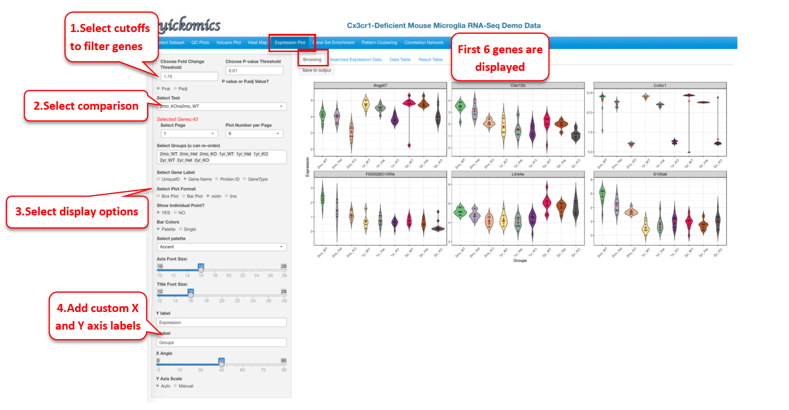

# Heatmap Module

This module generates highly customized publication-quality heatmaps with the ComplexHeatmap package in R. The genes for the heatmap are chosen under “Genes used for heatmap” in four ways: “All” plots random genes or the most variable genes (those with the highest standard deviation relative to their mean expression), 100 by default and up to 5,000; “Subset” plots the DEGs/DEPs of one comparison that pass the fold change and P value (or adjusted P value) cutoffs; “Upload Genes” takes a pasted gene list, or an annotated gene file whose annotations are shown next to the rows; and “Geneset” takes a gene set chosen with the gene set search described in Section 1.1. The “Static Heatmap Layout 1” and “Interactive Heatmap” tabs are drawn when Users click the “Plot/Refresh” button, so several settings can be changed before the heatmap is drawn again, while “Static Heatmap Layout 2” is redrawn automatically.

## Static Heatmap Layout 1

The “Static Heatmap Layout 1” uses the ComplexHeatmap package ([Gu et al., 2016](https://doi.org/10.1093/bioinformatics/btw313){target="_blank"}) for generating the plot. For demo purposes, we have selected options that highlight some capabilities to generate informative heatmap. For gene selection the default option is the selection of 100 random genes which can also be changed to variable genes. Here we selected DEGs/DEPs from the **2yr_WTvs2mo_WT** comparison. When the project has comparison information, “Use Samples from Test” limits the heatmap to the samples of the selected comparison. Users also have the option to change the cutoff criteria for filtering the genes. They can also add/remove annotation categories for the samples on the columns. In the example below, we used a Fold Change Cutoff of 2, which gives 464 genes, annotated the samples with Age, Gender and Genotype, and set “Reorder Samples by Annotation Attributes?” to “Yes”. The samples are then sorted by Age first, then by Gender and then by Genotype, instead of being clustered.

In this heatmap, the top up-regulated genes in **2mo_WT** samples are seen as high in 2mo samples but low in 2yr and 1yr samples, while the top up-regulated genes in the **2yr_WT** samples are high in the 2yr and 1yr samples but low in the 2mo samples. Because the samples are grouped by Age, these blocks are easy to see. This is another example that age has a major effect on gene expression in microglia, and the 2mo microglia have a different gene expression profile compared to 1yr and 2yr.

In this next example, we customize another heatmap. We selected genes from the 2mo_KOvs2mo_WT comparison and raised the Fold Change Cutoff to 1.43, which gives 236 genes. We limited the sample annotations to Age and Genotype, set “Reorder Samples by Annotation Attributes?” to “No” so that the samples are clustered, and changed the font sizes. Under “Show More Options”, we changed the Low, Mid and High colors and set “cutree_rows” to 4, so the genes are cut into 4 parts.

Other settings in the left panel include “Apply Clustering” (both, row, column or none), “Apply Scaling” (row by default), the font sizes, the gene label and “Max Number of Genes to Label”. “Show More Options” also sets the annotation colors (automatically from a random seed, from selected palettes, or from an uploaded file), highlights a subset of genes listed in an uploaded file (“Highlight Subset of Genes”), and sets the heatmap height, whether to show the row and column dendrograms, the distance metric and linkage algorithm used for clustering, and the row and column titles. “Save GCT data file to output” saves the heatmap data, which can be downloaded from the Output module (Chapter 15). To keep the plots fast, the two static heatmaps show at most 5,000 genes; when more genes are selected, 5,000 of them are picked at random.

## Static Heatmap Layout 2

The “Static Heatmap Layout 2” uses the heatmap.2 function from the gplots package for generating the plot. This layout has its own options for the color key, the angle of the column labels, the font sizes and the margins, and it uses the same clustering and scaling settings as Layout 1. Here is a demo with 100 random genes with dendrograms for both rows and columns.

## Interactive Heatmap

The “Interactive Heatmap” tab shows the selected genes in Morpheus, a heatmap viewer that runs in the browser and has no limit on the number of genes. Click “Plot/Refresh” to draw the heatmap. It uses the same “Annotate Samples”, clustering, distance and linkage settings as Static Heatmap Layout 1. In the example below, we used the same 464 genes from 2yr_WTvs2mo_WT as in Section 6.1, and the line above the heatmap shows “464 rows by 93 columns”. The menus above the heatmap (File, Edit, View, Tools and Help) and the toolbar offer many functions; for example, “View → Fit To Window” shows all genes and samples at once, the search box finds genes (with “Rows” selected) or samples (with “Columns” selected), and the “Tools” menu offers clustering, sorting, filtering and other analyses.

“Click to view Interactive Heatmap Guide” opens a short guide with a link to the [Morpheus tutorial](https://software.broadinstitute.org/morpheus/tutorial.html){target="_blank"}, which describes these functions in detail. The tutorial uses its own example data, so its steps for opening data files can be skipped; in Quickomics the data are loaded automatically.

