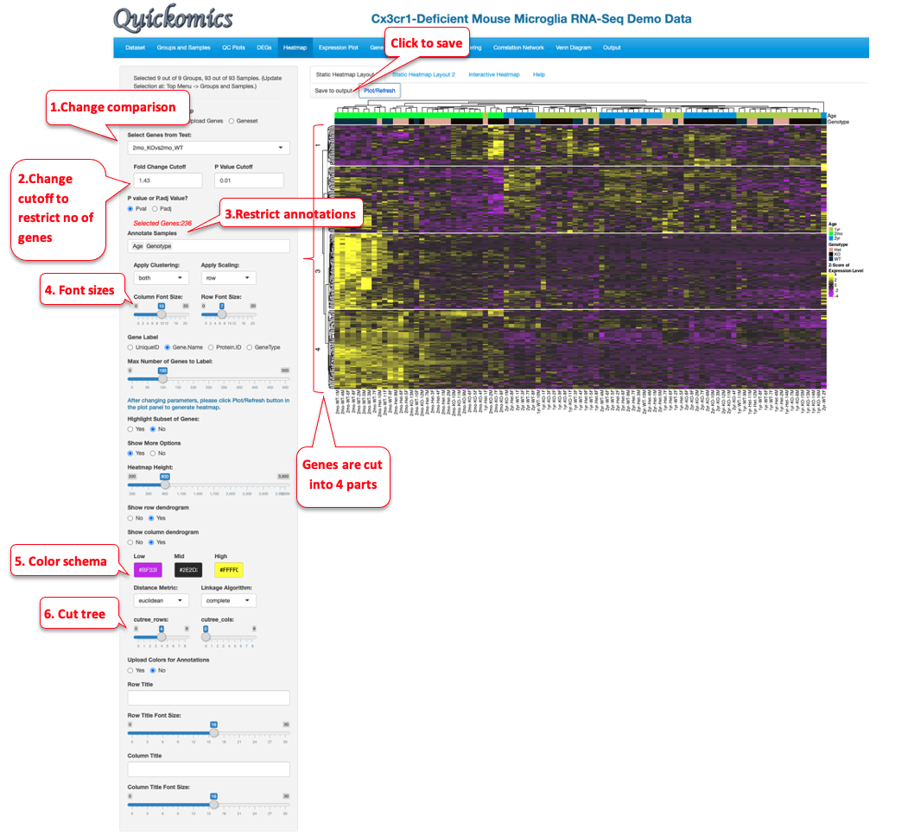
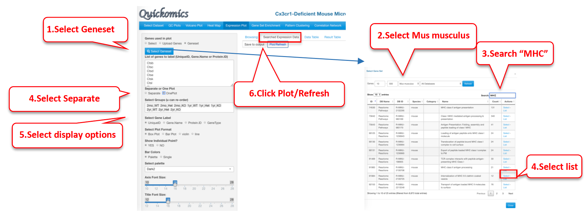
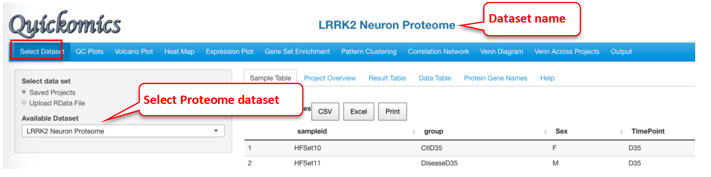

# Heatmap Module

This module generates highly customized publication-quality heatmaps with the ComplexHeatmap package in R. Users can enter automated list of differentially expressed genes or enter a custom list of genes to highlight on the heatmap. This module differs from other modules in that each time Users change the attributes; they need to click on the “Plot/Refresh” button to generate the plot. This is to avoid changing the output before all the attribute are added.

## Static Heatmap Layout 1

The “Static Heatmap Layout 1” uses the ComplexHeatmap package (Gu et al., 2016) for generating the plot. For demo purposes, we have selected options that highlight some capabilities to generate informative heatmap. For gene selection the default option is the selection of 100 random genes which can also be changed to variable genes. Here we selected DEGs/DEPs from the **2yr_WTvs2mo_WT** comparison. Users also have the option to change the cutoff criteria for filtering the genes. They can also add/remove annotation categories for the samples on the columns.

In this heatmap, the top up-regulated genes in **2mo_WT** samples are seen as high in 2mo samples but low in 2yr and 1yr samples, while the top up-regulated genes in the **2yr_WT** samples are high in the 2yr and 1yr samples but low in the 2mo samples. This is another example that age has a major effect on gene expression in microglia, and the 2mo microglia have a different gene expression profile compared to 1yr and 2yr.

In this next example, we customize another heatmap. We selected genes from the 2mo_KOvs2mo_WT comparison and raised the Fold Change Cutoff to 1.43, which gives 236 genes. We limited the sample annotations to Age and Genotype and changed the font sizes. Under “Show More Options”, we changed the Low, Mid and High colors and set “cutree_rows” to 4, so the genes are cut into 4 parts.

## Static Heatmap Layout 2

The “Static Heatmap Layout 2” uses the heatmap.2 function from the gplots package for generating the plot. Here is a demo with 100 random genes with dendrograms for both rows and columns.

## Interactive Heatmap

The “Interactive Heatmap” tab shows the selected genes in Morpheus, a heatmap viewer that runs in the browser and has no limit on the number of genes. Click “Plot/Refresh” to draw the heatmap. In the example below, we used the same 464 genes from 2yr_WTvs2mo_WT as in Section 6.1, and the line above the heatmap shows “464 rows by 93 columns”. The menus above the heatmap (File, Edit, View, Tools and Help) and the toolbar offer many functions; for example, “View → Fit To Window” shows all genes and samples at once, the search box finds genes (with “Rows” selected) or samples (with “Columns” selected), and the “Tools” menu offers clustering, sorting, filtering and other analyses.

“Click to view Interactive Heatmap Guide” opens a short guide with a link to the [Morpheus tutorial](https://software.broadinstitute.org/morpheus/tutorial.html){target="_blank"}, which describes these functions in detail. The tutorial uses its own example data, so its steps for opening data files can be skipped; in Quickomics the data are loaded automatically.

