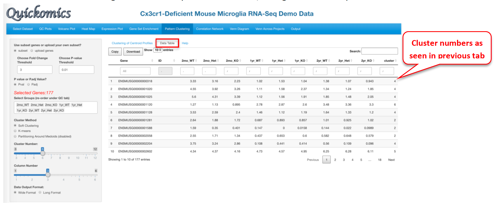
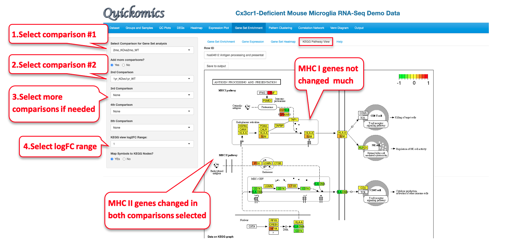

# Gene Set Enrichment Module

This functionality in Quickomics is an extension to the differential gene identification. Users are able to use different cutoffs to filter out DEGs/DEPs in different comparisons and probe enriched pathways. This is a useful way to make biological sense of the data. In the current version, the module offers two enrichment methods, Gene Set Enrichment Analysis (GSEA, Section 8.1) and Over-Representation Analysis (ORA, Section 8.2), and several views of the results: Gene Expression (8.3), Gene Set Heatmap (8.4), KEGG Pathway View (8.5), WikiPathways View (8.6) and Dot Plot (8.7).

The two major updates of this module in the current version are multi-comparison support and the Dot Plot. GSEA and ORA can now be run for several comparisons at once by selecting them under “Select 1 or More Comparisons for Analysis” (or checking “Select All Comparisons”), and the KEGG Pathway View can show the fold changes of several comparisons in the same pathway diagram. The new Dot Plot (Section 8.7) then summarizes the GSEA or ORA results of these comparisons in one figure, so that the enriched gene sets can be compared across comparisons at a glance.

This module always uses all samples and comparisons of the project, not the selection made in the “Groups and Samples” module (Chapter 3).

## Gene Set Enrichment Analysis (GSEA)

The “Gene Set Enrichment Analysis (GSEA)” tab tests whether the genes of a gene set change together in a comparison.

Select the comparison(s), the ranking method, the gene set size range, the adjusted P-value cutoff and the gene set collections, then click “Compute/Refresh”. By default, gene sets with 15 to 1,000 genes are tested and those with an adjusted P value below 0.25 are listed; checking “Collapse Gene Sets” keeps only the independent gene sets and leaves out those that mostly overlap with a more significant one.

In the results table, a positive normalized enrichment score (NES) means that the gene set is up-regulated, and a negative NES means that it is down-regulated. The “Copy Leading Edge Genes” button copies the genes that drive the enrichment, so that they can be pasted into other modules. Clicking a gene set name in the GSEA or ORA results table selects it for the Gene Expression, Gene Set Heatmap, KEGG Pathway View and WikiPathways View tabs.

To demonstrate usage of this functionality, we will use the Mouse Microglia RNA dataset to help answer the question which pathways were altered by Genotype and/or Age. Very similar to the results from [Gyoneva et al., 2019](https://www.life-science-alliance.org/content/2/6/e201900453){target="_blank"}, this analysis points to immune related terms being down-regulated in 2mo_KOvs2mo_WT. In the example below for 2mo_KOvs2mo_WT, complement and coagulation cascades and viral protein interaction with cytokine and cytokine receptor have negative NES values; the same pathways are also found by ORA in the down-regulated genes (Section 8.2).

## Over-Representation Analysis (ORA)

The “Over-Representation Analysis (ORA)” tab tests whether the DEGs/DEPs of a comparison are over-represented in gene sets. Unlike GSEA (Section 8.1), which ranks all genes of a comparison by logFC or by -log(P-Value) and tests whether the genes of a gene set are found at the top or bottom of the ranked list, ORA uses only the genes passing the cutoffs.

Users pick one or more comparisons, apply cutoff criteria, choose up-, down- or both-regulated genes, and select the gene set collections; then click “Compute/Refresh” to run the analysis. Gene sets with an adjusted P value below 0.05 (“ORA p.adj Cutoff”) are listed, and “Collapse Gene Sets” works as in GSEA.

Instead of the DEGs/DEPs of a comparison, “Genes Used for ORA” can also be set to “Gene List” to test a pasted list of genes, against either the genes in the current project or the genes in the gene sets as background (“Background Genes”); in this case the Gene Expression, Gene Set Heatmap and KEGG Pathway View tabs are not available.

Gene sets are available for human, mouse and rat. “Gene Set Species” is set to the species of the project when it is human, mouse or rat. When the gene sets come from another species than the project, “Gene Symbol Mapping” converts the gene symbols; it is set to “Homologous Genes” automatically, and the symbols can also be changed to upper case (human) or title case (mouse/rat), or used as they are. These settings, as well as “Add Custom GeneSet”, which adds gene sets entered in a text box or uploaded as a GMT file, apply to both GSEA and ORA.

In the example below, we used the same comparison, 2mo_KOvs2mo_WT, with human KEGG pathways with homologous gene mapping, a Fold Change Cutoff of 1.43 and a P value cutoff of 0.01; the top down-regulated pathways include cytokine-cytokine receptor interaction, viral protein interaction with cytokine and cytokine receptor, complement and coagulation cascades, and hematopoietic cell lineage.

Similarly, we select the up-regulated genes. Four KEGG pathways are enriched: rheumatoid arthritis, antigen processing and presentation, fluid shear stress and atherosclerosis, and leishmaniasis.

## Gene Expression

For the enriched terms identified in the GSEA (Section 8.1) or ORA (Section 8.2) tab, Users have the ability to look at the differential values of the genes present in the set. Click a gene set name in the ORA or GSEA results table, then open the “Gene Expression” tab. It shows the statistics of the gene set and lists all genes in the set with their logFC, P value and adjusted P value; the DE genes used in the ORA, or the leading-edge genes of a GSEA gene set, are shown in green. Here we are probing hsa04061 Viral protein interaction with cytokine and cytokine receptor, identified in the down-regulated category; 7 of its 42 genes, such as CX3CR1, CCR2 and CCR5, are down-regulated DE genes.

## Gene Set Heat Map

Like the “Gene Expression” tab, Users have the ability to plot expression of the genes in the pathway term selected as a heatmap. For each gene in the set, the heatmap shows the mean expression of the samples in each group (the “group” attribute), scaled per gene (z-score). “From the Gene Set, Show” chooses between all genes of the set and only the DE genes (ORA) or leading-edge genes (GSEA). This visualization shows that while the genes of the cytokine-cytokine receptor interaction pathway are enriched in the down-regulated genes, not all of them change in the same direction across the groups.

## KEGG Pathway View

This functionality is available only to KEGG pathway terms. Users have the option to view the Fold Change levels of different genes in the KEGG pathway selected for one or more comparisons. In this example we demo the KEGG pathway “hsa04612 Antigen processing and presentation” for the 2mo_KOvs2mo_WT and 1yr_KOvs1yr_WT comparisons. Each gene box shows one color per comparison. “Gene log2FC Range” and “Compound log2FC Range” set the log2 fold change that gets the full color, and “Map Symbols to KEGG Nodes?” labels the gene boxes with the gene symbols.

This figure identifies all the genes that are differentially expressed in this pathway. Most genes in the MHC I pathway change little, while CD74 in the MHC II pathway is down-regulated in both comparisons. The visualization is also useful to highlight whether or not a large proportion of genes in a pathway are altered by the perturbation.

## WikiPathways View

This tab shows the logFC values of the selected comparison on a WikiPathways diagram. Select a pathway by clicking its name in the ORA or GSEA results table, or choose it from the “Wikipathways for Visualization” list. The colors for low, middle and high logFC values and the log2FC range can be changed in the left panel. In the example below, we show the Microglia pathogen phagocytosis pathway (WP3937) for 2mo_KOvs2mo_WT; up-regulated genes are shown in red and down-regulated genes in green.

## Dot Plot

The Dot Plot compares the enrichment results of several comparisons in one figure.

First run GSEA or ORA for the comparisons of interest and choose the same “Analysis Type” in the left panel. The comparisons to plot can be re-ordered or removed by dragging them.

Choose how the top gene sets are selected (from each comparison separately, 10 by default and up to 30 per comparison; from all comparisons together, 30 by default and 3 to 100 in total; or from a customized list) and whether to plot all results or only the significant ones, then click “Plot/Refresh”.

The table above the plot lists how many of the plotted gene sets come from each comparison. The dot size shows -log10 of the adjusted P value, and the dot color shows the NES for GSEA results or the number of DE genes in the gene set for ORA results.

In the example below, we ran GSEA for 2mo_KOvs2mo_WT, 1yr_KOvs1yr_WT and 2yr_KOvs2yr_WT and plotted the top 30 KEGG pathways.

