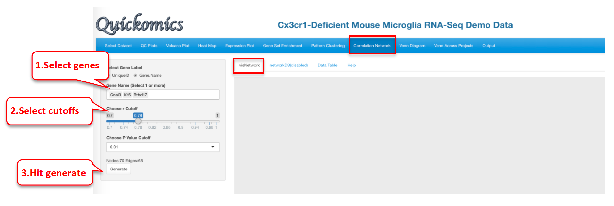
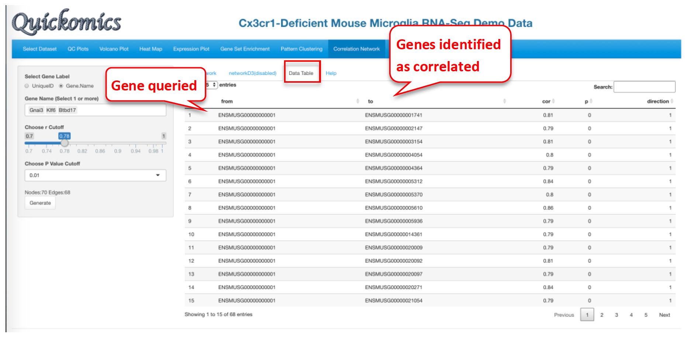

# Pattern Clustering Module

This functional module in Quickomics helps cluster genes/proteins based on their expression profiles across different groups. Three different algorithms, soft (fuzzy) clustering, k-means and partitioning around medoids (PAM), are implemented.

## Clustering of Centroid Profiles

Users have the option to either select the DEGs/DEPS as the list of genes/proteins to cluster based off on or upload a custom gene list. DEGs/DEPs can be selected from one comparison or from all comparisons, and cutoffs can be applied to limit the number of genes. Users also choose the sample attribute to plot, how the expression values are transformed before clustering (“Cluster On”, described in the guide above the plot), and the order of the groups; then click “Plot/Refresh”. In this example below, we select the DEGs/DEPs from all comparisons with a Fold Change cutoff of 3 and a P value cutoff of 0.01, which gives 177 genes, and identify 6 clusters of genes.

Please note that this visualization for this dataset is novel and was not previously reported in [Gyoneva et al., 2019](https://www.life-science-alliance.org/content/2/6/e201900453){target="_blank"}. The genes in each cluster can be viewed in the “Data Table” tab.

## Data Table

The data table contains genes from the previous clusters, along with their gene names and the values used for clustering, here the z-scores of the group means; the “cluster” column gives the cluster number shown in the previous tab. The layout of the table is set by “Data Output Format” in the left panel. By default, the table is shown in the wide format: each gene is shown in one row, the values of the groups are in separate columns, from 2mo_WT to 2yr_KO, followed by the cluster number.

In the long format, each gene is shown in one row per group. In this example there are nine groups, so each gene appears in nine rows, and the table has 1,593 rows for the 177 genes. Each row gives the group, the gene, the “mean” column with the mean expression of the gene in that group, the “value” column with the z-score used for clustering, and the cluster number. For example, Clec10a has a mean expression of 3.33 in 2mo_WT and 1.38 in 2yr_WT; after the z-score transformation these become 1.69 and -0.391, and the gene belongs to cluster 2, the genes that are high in the 2mo groups and low in the 1yr and 2yr groups. The long format is useful when the table is downloaded to make plots or to filter the data in other software.

