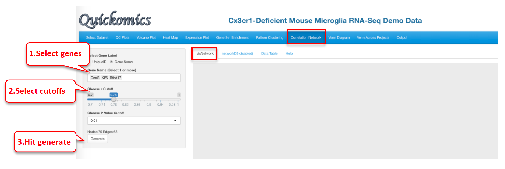
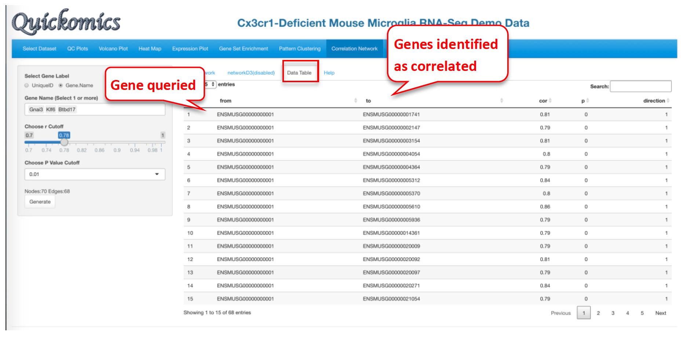

# WGCNA Module

Weighted Gene Co-expression Network Analysis (WGCNA) finds groups of genes, called modules, whose expression goes up and down together across the samples. Genes in the same module often work in the same biological process. Each module is summarized by its eigengene, a single profile that represents the expression of all genes of the module, and the eigengenes can be correlated with sample attributes such as Age or Genotype to find the modules linked to them.

WGCNA takes a long time to compute, so Quickomics loads pre-computed results when a project has them. For the Mouse Microglia demo dataset, the results were pre-computed with the 10,000 most variable genes and a Dendrogram Cut Height for Merging of 0.25, and they are shown as soon as the WGCNA tab is opened. Users can change the number of genes or the cut height in the left panel and click “Run” to compute new results; this can take 3–10 minutes.

The pre-computed results use all samples of the project, while “Run” uses the samples selected in the “Groups and Samples” module (Chapter 3). When the selected samples are the same as those of the pre-computed results and the number of genes is unchanged or within 10%, for example when only the cut height is changed, “Run” reuses the saved pre-computed data and finishes faster. Otherwise, everything is computed again from the start, including the soft-thresholding power, and the process takes several minutes.

The tabs are described below in the order of a typical analysis: WGCNA QC (Section 9.1), WGCNA Result (9.2), Module Eigengenes (9.3) and Module-Trait Relationships (9.4). In the app, WGCNA QC is the fourth tab, after Module-Trait Relationships. Each tab has a green link that opens a short guide, and the “Help” tab describes the whole workflow.

## WGCNA QC

Before the network is built, WGCNA raises the correlations between genes to a power, called the soft-thresholding power. A higher power keeps the strong correlations and pushes the weak ones toward zero. The “Soft-Thresholding Power” sub-tab shows how well the network fits a scale-free topology (SFT.R.sq) and the mean connectivity of the genes for each power. The usual choice is the lowest power with an R² above 0.8, which is marked by the red line in the Scale Independence plot. For the demo dataset, power 6 is the first power above this line, with an R² of 0.906 and a mean connectivity of 301, and it is highlighted in the table as the power used.

The “WGCNA Network” sub-tab helps check the data before the network is built. The histogram shows the distribution of the gene variance across the samples; WGCNA uses only the most variable genes, set by “Select Top N Genes”, to reduce noise and computing time. The dendrogram below clusters the samples by their overall expression profiles. Samples of the same group are expected to cluster together, and a sample that joins the others only at a much greater height may be an outlier; such a sample can be removed in the “Groups and Samples” module before clicking “Run” again.

## WGCNA Result

The “Dendrogram Plot” sub-tab shows how the genes are clustered by their co-expression. The colored bar below the tree shows the module of each gene: genes of the same module share a color, and grey genes are not assigned to any module. Modules whose eigengenes are very similar are merged; a lower “Dendrogram Cut Height for Merging” keeps more, smaller modules.

The “Gene Cluster Summary Table” sub-tab lists each module with its number of genes and the genes it contains. In the demo dataset there are six modules plus 4,238 grey genes, with sizes from 79 genes in the red module to 2,569 genes in the turquoise module. For each module, “Copy all genes” copies its genes so that they can be pasted into other modules of Quickomics, and “Run ORA” runs Over-Representation Analysis on its genes (see Section 8.2). For example, the yellow module includes Xist and Tsix. “Save GCT data file to output” saves the expression data with the module of each gene, which can be downloaded from the Output module (Chapter 15).

## Module Eigengenes

The “Eigengene table” sub-tab lists the eigengene value of every module in every sample. Each row is one sample and each column is one module. In the example below, the blue module (ME5_blue) has positive values in the 2mo samples, which matches its high correlation with Age2mo in Section 9.4. The table can be saved with “Save to output”.

The “Eigengene Network” sub-tab shows how the modules relate to each other. In the tree at the top, modules with similar eigengenes are joined at a lower height; in the heatmap below, red means that two eigengenes are similar and blue means they are not. In the demo dataset, the blue and brown modules are joined first, and the red module is close to them.

## Module-Trait Relationships

The “Module Trait Heatmap” sub-tab correlates the eigengene of each module with the sample attributes. Select the attributes, choose a base level for each, and click “Plot Module Trait Correlation”.

Each level of an attribute becomes one column of the heatmap; red cells mean that the genes of the module are, on average, more highly expressed in the samples of that level than in the other samples, and blue cells mean that they are less expressed. Hovering over a cell shows the correlation and its P value, and clicking a cell opens the “Hub Gene Identification Table” sub-tab with the trait and the module of that cell already selected.

In the example below, we selected Age, Genotype and Gender. The blue module has the strongest correlation, 0.94 with Age2mo, so its genes are higher in the 2mo samples. The green module shows the opposite pattern, with a correlation of −0.87 with Age2mo and 0.79 with Age2yr. As in the earlier chapters, Age has a much larger effect than Genotype, and the yellow module, which includes Xist and Tsix, is correlated with GenderF.

Hub genes are the most connected genes of a module and are often key genes of the process it represents.

In the “Hub Gene Identification Table” sub-tab, select a trait and optionally a module, then click “Run”; when the sub-tab is opened by clicking a cell of the heatmap, the trait and module are already filled in, and only “Run” needs to be clicked.

For each gene, the table lists its connectivity within the module, its module membership (the correlation of the gene with the module eigengene) and its gene significance (the correlation of the gene with the trait), with their P values.

In the example below, we clicked the cell of the blue module and Age2mo in the heatmap above, so the trait Age2mo and the module ME5_blue were filled in, and then clicked “Run”. The 895 genes are sorted by connectivity, and the top hub genes include several histone genes, such as Hist1h2ac, Hist4h4 and Hist1h3e.

The “Hub Gene Identification Plot” sub-tab shows the same results as two plots. Both plots are made by the same “Run” as the table, for the same trait and module, and each dot is one of the 895 genes in the table; hovering over a dot shows its row of the table. In the example below, the dot at the top right of the right plot is Hist1h2ac, the first gene of the table.

The left plot compares the module membership and the gene significance of each gene; in the blue module they are highly correlated (cor = 0.968), which means that the genes most central to the module are also the most related to Age2mo.

The right plot shows the connectivity of each gene against its module membership, and the top 10% most connected genes, the hub genes, are shown in red; they are the genes at the top of the table.

