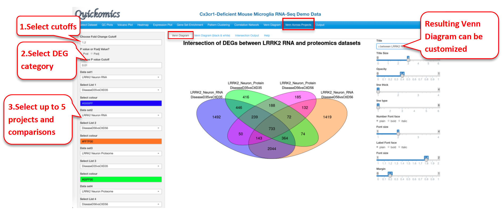
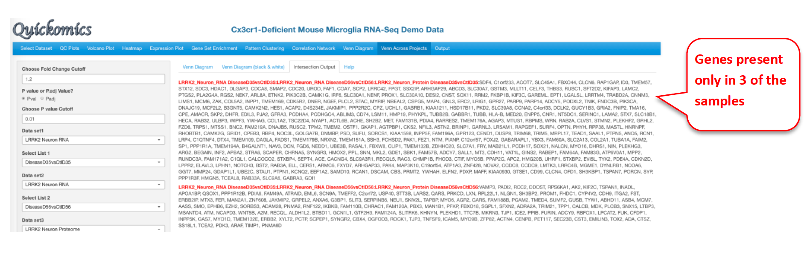
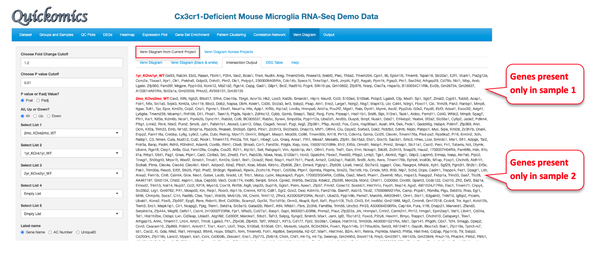
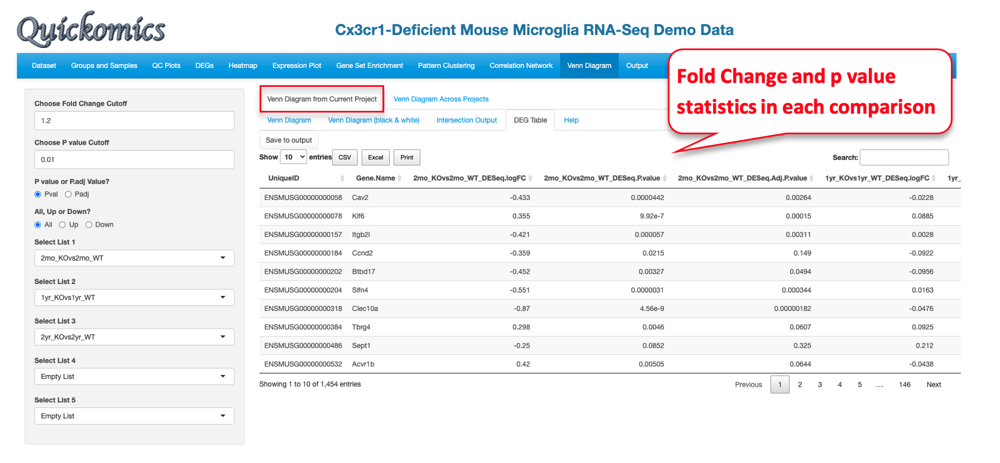

# Venn Diagram Module

This module in Quickomics helps Users identify DEGs/DEPs that are common or unique to different comparisons. The DEGs/DEPs are shown as a Venn diagram that can be customized, and as tables that list the genes. The tabs of “Venn Diagram from Current Project” are described below: Venn Diagram (Section 11.1), Venn Diagram (black & white) (11.2), Intersection Output (11.3) and DEG Table (11.4). The “Venn Diagram Across Projects” tab works in a similar way with comparisons from different projects.

## Venn Diagram

To view the DEGs/DEPs as a Venn Diagram, Users have the option to select the fold change and P value cutoffs, whether to use all DEGs/DEPs or only the Up or Down regulated ones, and up to 5 comparisons, each with its own color. In the example below, we used a fold change cutoff of 1.2 and a P value cutoff of 0.01, and selected the three KO vs WT comparisons, 2mo_KOvs2mo_WT, 1yr_KOvs1yr_WT and 2yr_KOvs2yr_WT. The panel on the right customizes the diagram, for example its title, the opacity of the colors, the lines and the fonts. Long comparison names can be wrapped onto several lines with “Wrap Labels At (characters)”, or shown as a legend below the diagram. “Save to output” saves the diagram to the Output module (Chapter 15).

In this example there were 33 DEGs that were identified in the three comparisons probed here, which represent the set of genes altered by the KO genotype at each of the time points.

## Venn Diagram (black & white)

This tab has the same plot seen before in Section 11.1 but highly simplified and in black and white.

## Intersection Output

This tab lists the genes in each region of the Venn diagram, one row per region. The “Intersection” column gives the comparisons that share the genes, one name per line; “Count” gives the number of genes, and “Genes” lists them. Long lists show the first 50 genes; click “Show all” to see the rest. “Label name” in the left panel sets whether the genes are shown by gene name, accession number or UniqueID. To copy genes, click one or more rows; the “Copy Selected Gene List” button then copies the genes of all selected rows, without duplicates, so that they can be pasted into other modules. In the example below, we selected the 40 genes found in 2mo_KOvs2mo_WT and 2yr_KOvs2yr_WT and the 33 genes found in all three comparisons, 73 genes together.

## DEG Table

This tab lets the Users view the Fold Change and p value of the genes identified in the Venn Diagram in the comparisons being queried. The table includes every gene found in at least one of the selected comparisons, 1,454 genes in this example, with its log fold change, P value and adjusted P value in each comparison. The table can be downloaded with the CSV and Excel buttons, or saved with “Save to output”.

